# ZenZX

A ZX Spectrum emulator in Go, built on the [zen80](https://github.com/ha1tch/zen80) Z80 core.

| Machines | |
|---|---|
| ZX Spectrum 48K, 128K, +2, +2A, +3 | Tape, snapshots, `.rzx` recordings (played), AY sound, the +3's disk drive |
| Timex Sinclair 2068 | Its own timing, screen modes, sound and joystick ports |
| ZX Spectrum Next | Boots NextZXOS from the distribution's SD card: Layer 2, tilemap, sprites, the copper, the DMA with DMA+, 4 MB, 28 MHz |

It builds two ways: a **GUI** (raylib, with sound) and a **headless** program with no window, which
runs a machine under a script and writes screenshots, for tests and for debugging guest software.
The GUI's menus and windows are [zenui](https://github.com/ha1tch/zenui), the toolkit it shares
with zenimate and zenplay; the rounded shapes of its machine dock are drawn by
[raycanvas](https://github.com/ha1tch/raycanvas).

Several machines can run at once, each reachable over a TCP socket and each autoloading a
program, as in `zenzx -multi 4:48k,48k,128k,next -listen 16384 -autorun hello.bas`. See
[`docs/link.md`](docs/link.md).

## ZX Spectrum

| | |
|---|---|
| 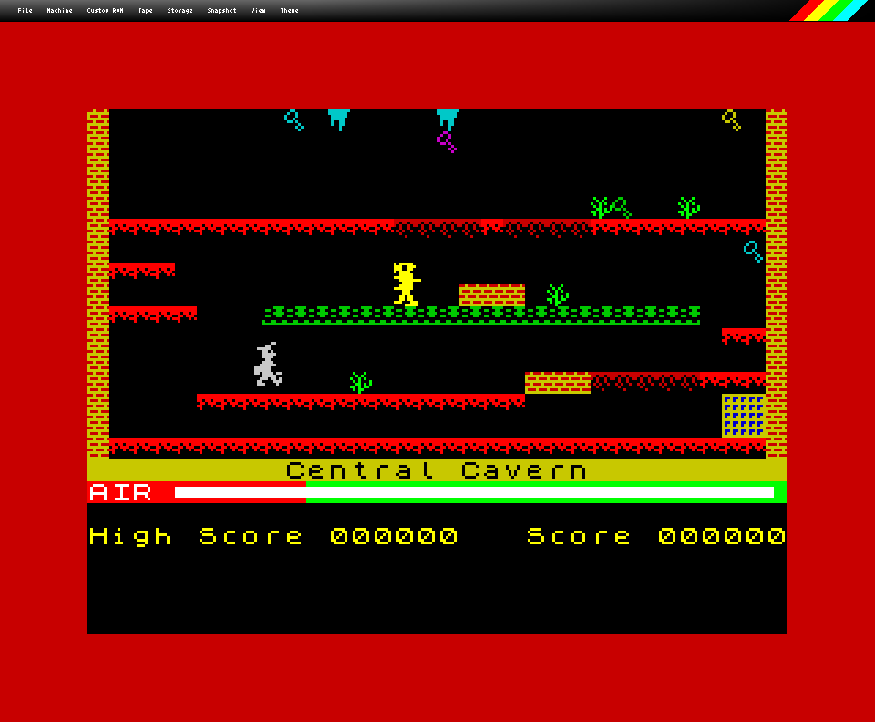 | 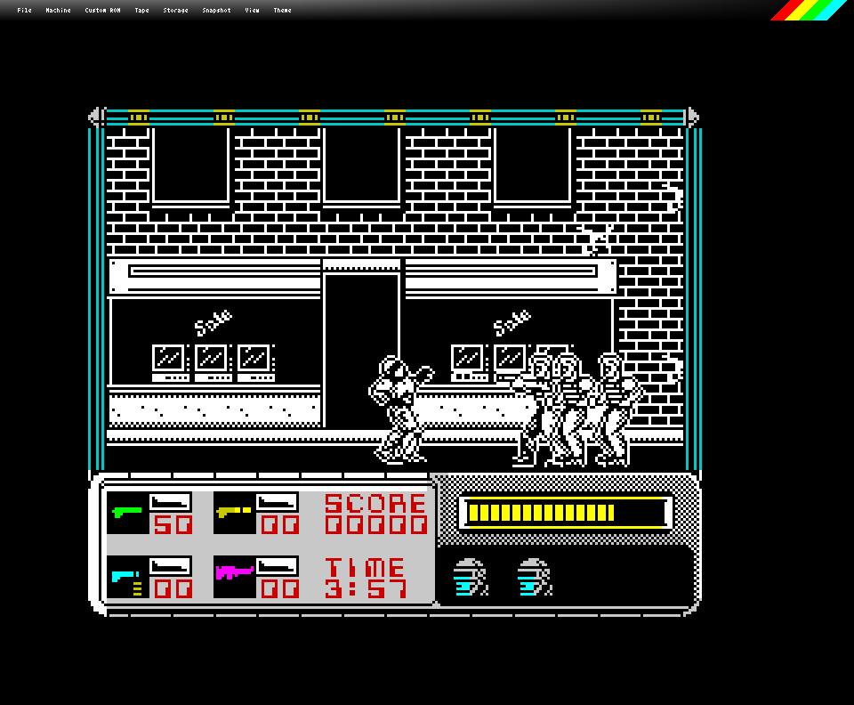 |
| Manic Miner, in the Central Cavern | RoboCop, on the first level |

## ZX Spectrum Next

| | | |
|---|---|---|
| 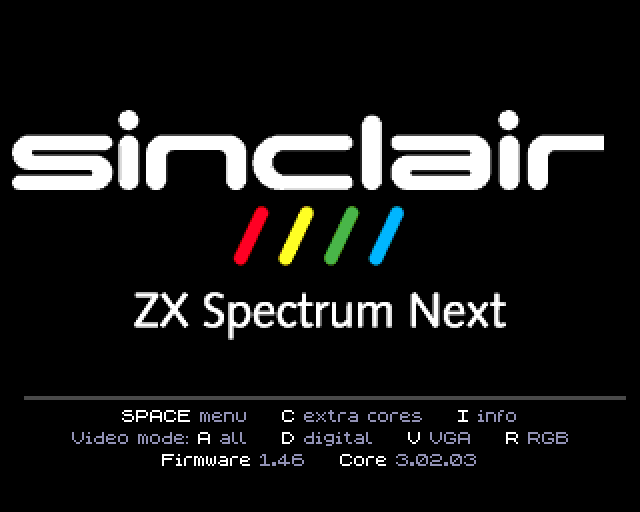 | 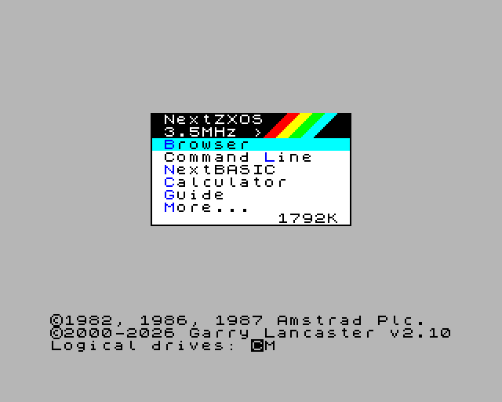 | 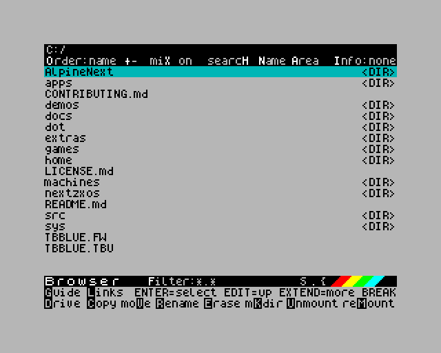 |
| The firmware's boot screen | The NextZXOS menu | The Browser |
| 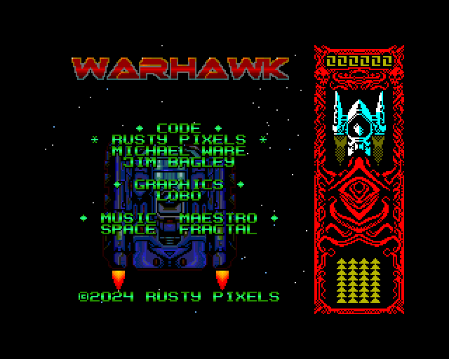 | 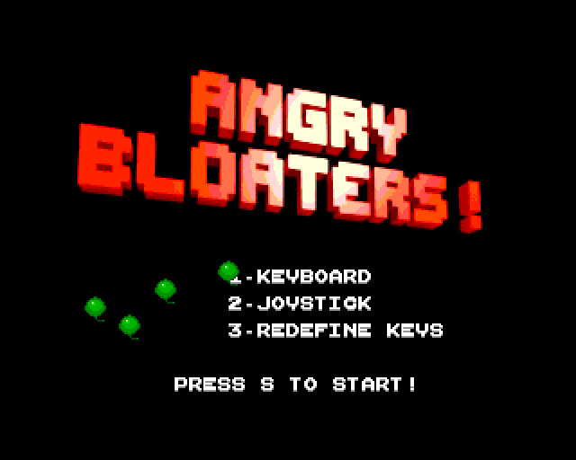 | 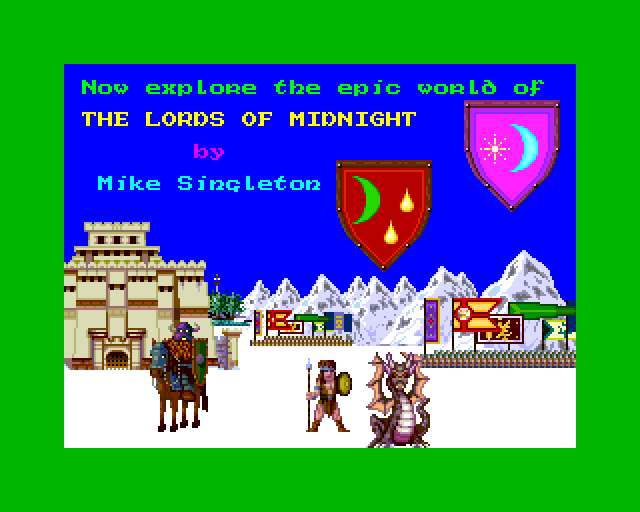 |
| Warhawk | AngryBloaters | The Lords of Midnight |
| 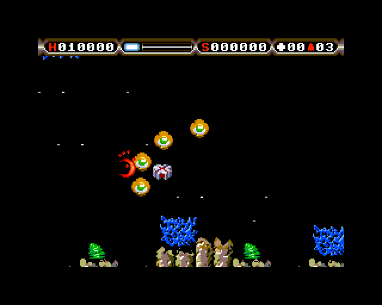 | 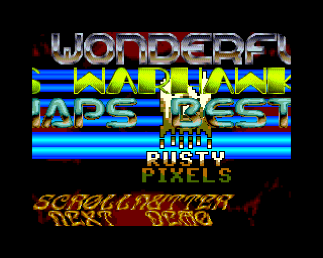 | 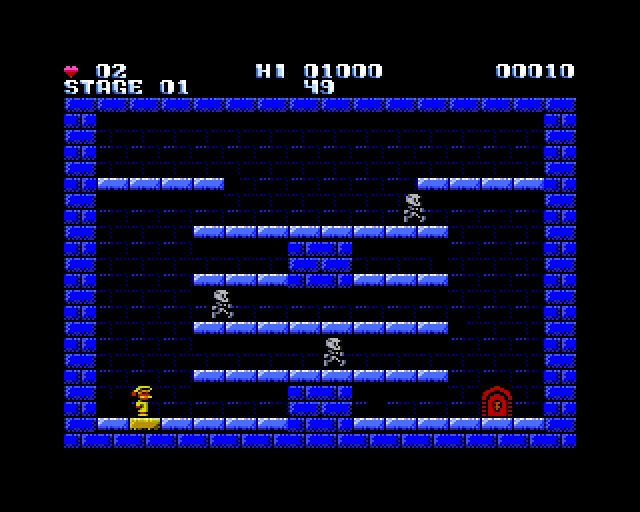 |
| TX-1696 | ScrollNutter | Night-Knight |

The games are from the card that comes with the Next's own distribution.
[`docs/next-programs.md`](docs/next-programs.md) lists the ones that were tried and how each
compares with CSpect and jnext, the two emulators the picture is checked against.

ZenZX comes with three examples of its own for the Next, written in Z80N assembly with
[zenas](https://github.com/ha1tch/zenas) and built with [zentools](https://github.com/ha1tch/zentools)'
`zx`, from pictures in the public domain. `zenzx -next-examples` puts them on a card for the
Next's second slot, where NextZXOS shows them as drive D; in the GUI the Storage menu's SD Card section does
the same. [`examples/next`](examples/next/README.md) has their sources and how they are
made, and [`next`](next/README.md) is the folder for the Next's cards and ROMs.

| | | |
|---|---|---|
| 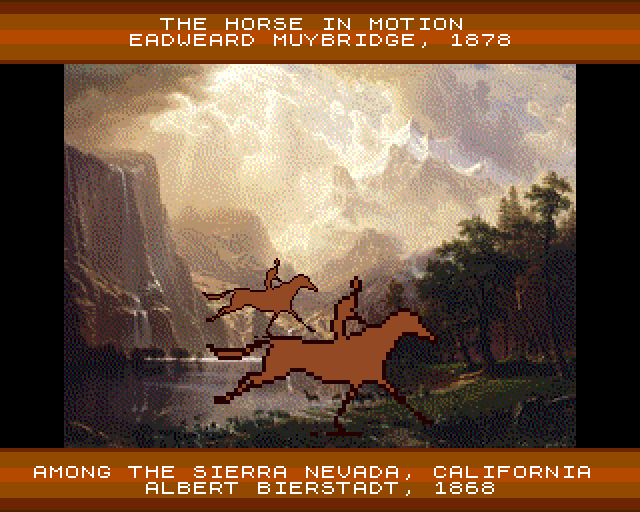 | 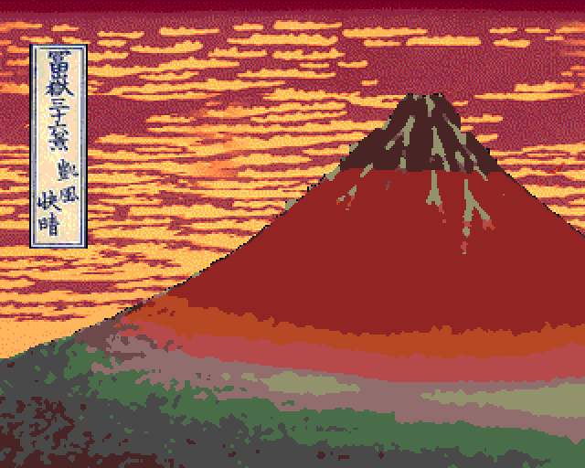 | 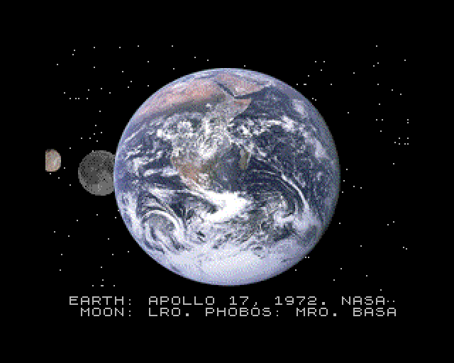 |
| gallop -- Muybridge's horse over a Bierstadt painting | fuji -- clouds behind Hokusai's Red Fuji | orbit -- the Moon and Phobos before the Earth |

## Installing

[The release page](https://github.com/ha1tch/zenzx/releases) and
[ha1tch.github.io/zenzx](https://ha1tch.github.io/zenzx/) have a `.deb` for Linux (amd64, arm64), a
`.msi` for Windows (amd64, arm64) and a `.dmg` for macOS, and the programs as they are, in archives and as
bare files. Windows 7 has a program of its own, 64-bit, as a `.zip` and a `.msi`; the others need Windows 10.
Nothing is signed, so Windows and macOS ask for permission the first time; the manual says how to give it
([Installing a release](docs/MANUAL.md#installing-a-release)).

Each release also has the manual as a PDF (`zenzx-<version>-manual.pdf`) and the examples as a zip
(`zenzx-<version>-examples.zip`). The examples start with a double click on Windows (`run.cmd`,
`chat.cmd`) and with `sh run.sh` elsewhere; when Python 3 or ZenZX is missing they say so, say where
to get it, and on Windows offer to fetch it
([The examples](docs/MANUAL.md#the-examples-and-their-launchers)).

## Building

Go 1.26.5 or later. On Linux the GUI also needs a C compiler and the raylib and oto system libraries
(OpenGL, X11 or Wayland, ALSA); the release builds the macOS and Windows GUI without one.

```
./build.sh            # the GUI
./build_headless.sh   # the headless program, no C compiler needed
```

The emulator is also a Go library, `github.com/ha1tch/zenzx`; see
[`docs/development.md`](docs/development.md) and [`docs/MACHINE_MAP.md`](docs/MACHINE_MAP.md).

## Running

```
./zenzx -model=48k
./zenzx -model=plus3
./zenzx -model=ts2068
./zenzx -model=next
./zenzx -tape=game.tap
```

The ROMs of the 48K to +3 and the TS2068 are in the program. A Next needs its firmware and SD
card, which are not: the first time it is started ZenZX explains this and, when asked to, downloads
them (about 70 MB, once) and checks them. `-help` lists every flag.

One window runs any number of machines: rest the mouse at the bottom edge, or press `Alt+M`, for
the dock that adds machines and flips between them.

A gamepad is the joystick, and on a Next the mouse is the Next's mouse; see the manual for the
choices.

## Drag and drop

Dropping a file on the window loads it into the machine by its extension. The same drop is routed
differently per machine and, for a Next, by whether it is sitting at its NextZXOS menu or Browser
(an *idle prompt*):

| File | 48K / 128K / +2 | +3 (with drive) | Next (running) | Next (at menu / Browser) |
|------|-----------------|-----------------|----------------|--------------------------|
| `.tap` / `.tzx` | load tape | load tape | load tape | **ask**: copy to SD, or load & run |
| `.scr` | paint screen | paint screen | paint screen | **ask**: copy to SD, or load & run |
| `.sna` / `.z80` / `.szx` / `.zxs` | restore snapshot | restore snapshot | restore snapshot | **ask**: copy to SD, or load & run |
| `.rzx` | play the recording (start the model it was made on first) | play the recording | not supported | not supported |
| `.dsk` | needs a +3 | mount & boot | needs a +3 | **copy to SD** (ZenZX doesn't mount Next disk images yet — T-72) |
| `.nex` | not applicable | not applicable | **run**, after asking to reset the busy Next | **ask**: copy to SD, or run it |
| **Shift held** | — | — | — | by default skip the prompt and **run** (same as *Load & Run*); a preference |

A `.nex` is a Next executable, so it does not apply to the classic models. On a Next it is run by
NextZXOS's own `.nexload`, started for you: from the menu or the Browser without a reset (the
file goes on the second SD card, and the keys to the command line are pressed), after a reset when
the Next is in the middle of something (you are asked first), and from a scratch boot card when
neither works. On a Next the **ask**
cases open a copy-or-run dialog; holding **Shift** at the drop is, by default, the same as pressing
*Load & Run* and skips it. What a plain drop does there (ask, copy to the card, or run) and what a
Shift drop does are both choices in **File > Preferences...**. *File > Open...* takes the same files
through the same routing, as a plain drop. "Run" for a disk means mount and boot it: on a +3 that is Drive A, and real NextZXOS
mounts disk images as its own drives, but ZenZX does not emulate that yet (T-72) — so for now a
`.dsk` dropped on a Next is copied to the card regardless of Shift. Dropping onto a
storage slot always copies the file there, whatever its type. [`docs/gui.md`](docs/gui.md) has the
full account.

## Documents

| Document | What is in it |
|---|---|
| [`docs/MANUAL.md`](docs/MANUAL.md) | The reference: flags, models, keyboard, joystick and mouse, media, the Next, configuration |
| [`docs/gui.md`](docs/gui.md) | The window: menu bar, `machines.json` and `settings.json`, keys, drag and drop |
| [`docs/headless.md`](docs/headless.md) | The headless program: the debugging workflow, loading binaries and screens, its flags |
| [`docs/link.md`](docs/link.md) | Several machines at once, the socket each one offers, and autorun |
| [`docs/ROMS.md`](docs/ROMS.md) | Where a machine's ROM comes from, how to replace it, patch it or make one |
| [`docs/zenscript.md`](docs/zenscript.md) | The scripts that drive a machine |
| [`docs/next-programs.md`](docs/next-programs.md) | The programs on the Next's card and how each fares |
| [`docs/NEXT_BOOT_REFERENCE.md`](docs/NEXT_BOOT_REFERENCE.md) | How a Next boots |
| [`docs/hardware-accuracy.md`](docs/hardware-accuracy.md), [`docs/timex-modes.md`](docs/timex-modes.md), [`docs/video-architecture.md`](docs/video-architecture.md) | How the hardware is modelled |
| [`docs/TRACKING.md`](docs/TRACKING.md) | What is open |
| [`docs/KNOWN_ISSUES.md`](docs/KNOWN_ISSUES.md) | Limits that are meant, and the tests that need a display or the Next's files |
| [`docs/RESOLVED.md`](docs/RESOLVED.md), [`CHANGELOG.md`](CHANGELOG.md) | What was closed, and what shipped |
| [`docs/CHANGELOG-ARCHIVE.md`](docs/CHANGELOG-ARCHIVE.md) | Full per-patch changelog detail for older minor versions the main changelog now summarises |
| [`docs/development.md`](docs/development.md) | Versioning, releases, continuous integration, the source's layout |
| [`docs/MACHINE_MAP.md`](docs/MACHINE_MAP.md) | What separates the machine from the two programs, for a program that imports it |
| [`docs/proposals/`](docs/proposals) | Designs, each with a note where what was built differs; [the installers](docs/proposals/installers.md) are one |
| [`TESTING.md`](TESTING.md) | The tests, generated from the source |
| [`docs/ZENBENCH.md`](docs/ZENBENCH.md) | Zenbench: what ZenZX and zenplay are both built from, and what is to come of it |

## Contact

Email: h@ual.li

https://oldbytes.space/@haitchfive

## Acknowledgements

With thanks to the friends who have supported our Spectrum projects from the
sidelines; see [`ACKNOWLEDGEMENTS.md`](ACKNOWLEDGEMENTS.md).

## Licence

Copyright (c) 2026 haitch

Licensed under the Apache License, Version 2.0: https://www.apache.org/licenses/LICENSE-2.0
