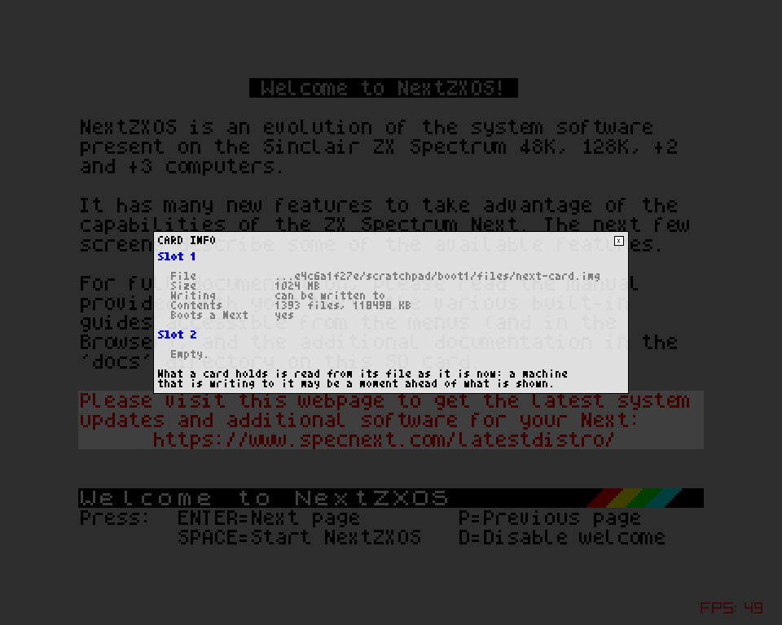
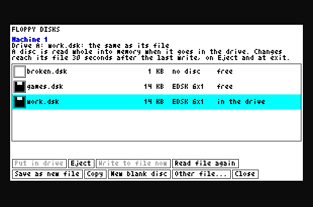
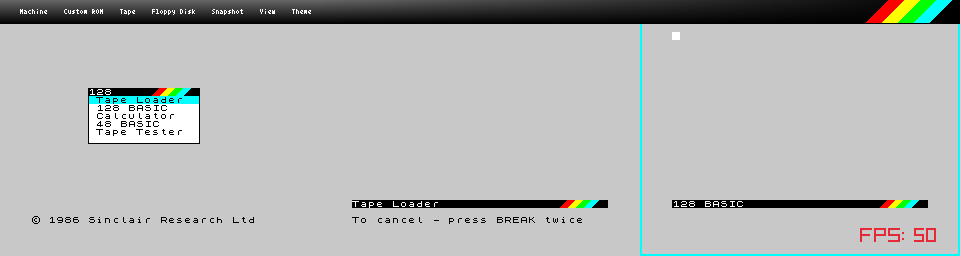
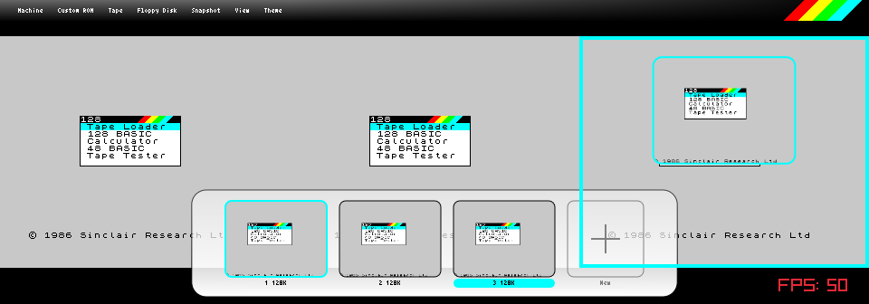
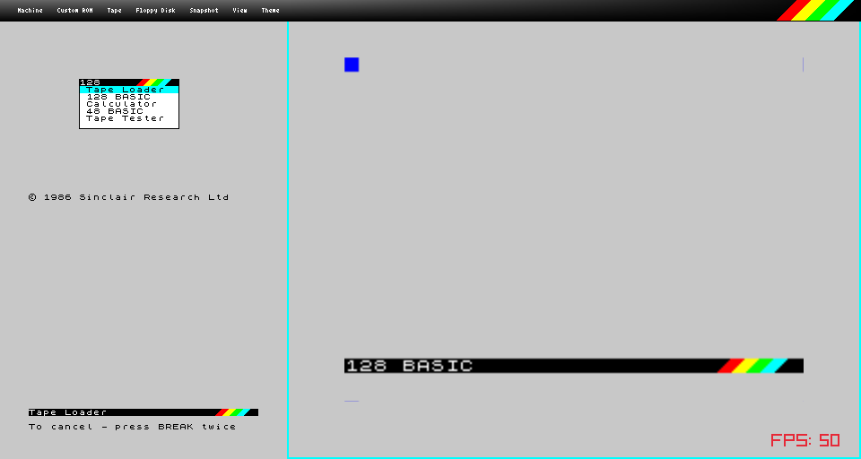
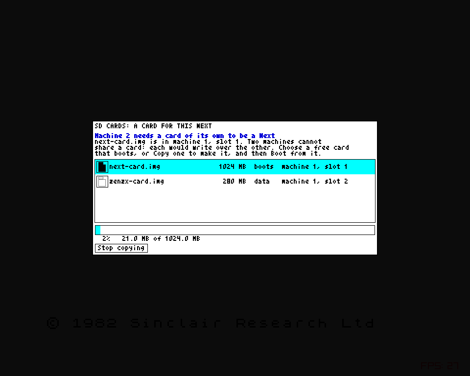
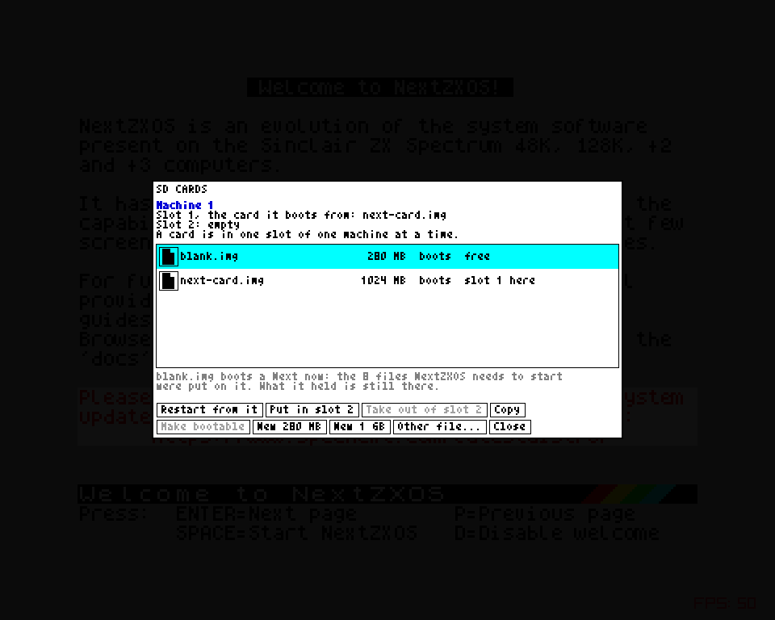
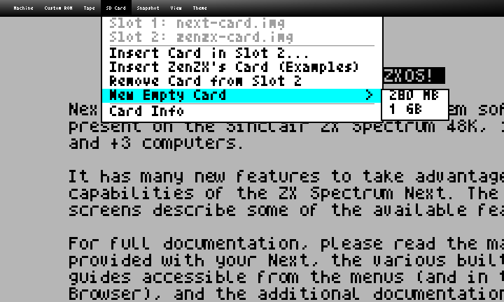

# ZenZX Manual

A reference for building, running, and driving ZenZX -- a ZX Spectrum
emulator in Go, built on the [zen80](https://github.com/ha1tch/zen80) Z80
CPU core. This manual is the reference. [`README.md`](../README.md) at the
project root is the short introduction; the longer accounts that used to be
there are in [`gui.md`](gui.md), [`headless.md`](headless.md) and
[`development.md`](development.md).

## Contents

1. [Overview](#overview)
2. [Installing and building](#installing-and-building)
3. [Quick start](#quick-start)
4. [Supported models](#supported-models)
5. [Command-line reference -- GUI](#command-line-reference--gui)
6. [Command-line reference -- headless](#command-line-reference--headless)
7. [Keyboard](#keyboard)
8. [Joystick and mouse](#joystick-and-mouse)
9. [Media formats](#media-formats)
10. [The menu bar (GUI)](#the-menu-bar-gui), [the Info windows](#the-info-windows-gui), [the +3's disks](#the-3s-disks-gui), [standalone programs](#standalone-programs-gui) and [several machines](#several-machines-gui)
11. [Configuration files](#configuration-files)
12. [Scripting with zenscript](#scripting-with-zenscript)
13. [Headless debugging workflow](#headless-debugging-workflow)
14. [ZX Spectrum Next](#zx-spectrum-next)
15. [Non-standard features](#non-standard-features)
16. [Known issues and further reading](#known-issues-and-further-reading)
17. [Versioning and releases](#versioning-and-releases)
18. [Project layout](#project-layout)
19. [License and contact](#license-and-contact)

## Overview

ZenZX emulates the 48K, 128K, +2, +2A, +3 (including the +3 floppy disk
controller), the Spanish-market variants of each of those, and the Timex
Sinclair 2068, with tape and snapshot support. It builds in two variants
from the same emulation core:

- **GUI** (default) -- raylib rendering with audio, for interactive use.
  On Linux it needs CGO and system libraries (OpenGL, X11/Wayland, ALSA); the
  macOS and Windows programs of a release are built without a C compiler.
- **Headless** (`-tags headless`) -- no window, no audio device, CGO-free.
  Boots a model, runs a fixed number of frames, and writes PNG screenshots
  of the screen decoded directly from display memory. Built for automated
  testing and for debugging guest software without a display.

Both share the same underlying machine emulation (`zenzx.go`, `memory.go`,
`io.go`, `fdc.go`, tape/snapshot/audio/joystick/mouse handling) -- the split
is only in front-end plumbing (windowing, audio device, input), so a
`.zen` script or a raw binary behaves identically in either build.

## Installing and building

### Installing a release

Every release ([github.com/ha1tch/zenzx/releases](https://github.com/ha1tch/zenzx/releases); the
newest is also at [ha1tch.github.io/zenzx](https://ha1tch.github.io/zenzx/)) has installers for
people who would rather not unpack anything, and the programs themselves:

| For | File | How |
|---|---|---|
| Debian, Ubuntu: amd64, arm64 | `zenzx_<version>_<arch>.deb` | `sudo apt install ./zenzx_<version>_amd64.deb`, with the file that matches `dpkg --print-architecture`. It puts `zenzx` in `/usr/bin`, with a menu entry and an icon, and needs a recent C library (Ubuntu 24.04, Debian 13), ALSA and X11: `apt` says when something is missing. `sudo apt remove zenzx` removes it. |
| Windows 10 and later: amd64, arm64 | `zenzx-<version>-windows-<arch>.msi` | Open it. It installs for the person who runs it, in `%LocalAppData%\Programs\ZenZX`, with no administrator and no questions, and adds a Start menu entry. Apps in Windows Settings removes it. The `arm64` file is for Windows on ARM. |
| macOS 12 or later: Intel and Apple silicon | `zenzx-<version>-macos-universal.dmg` | Open the image and drag ZenZX onto Applications. |
| Windows 7: 64-bit | `zenzx-<version>-windows7-amd64.zip` and `.msi` | The `.msi` as above, or unzip the folder and run `zenzx.exe`. It is a separate program, built with a patched Go compiler, because Go has not supported Windows 7 since version 1.21; the other Windows programs need Windows 10. |
| Any system | `zenzx-<version>-<os>-<arch>.tar.gz` (`.zip` on Windows) | Unpack and run `zenzx`: the program with the ROMs, the manual and the Next demo card beside it. |
| Any system, no window | the same names ending `-headless` | The headless program of [the headless section](#command-line-reference--headless). |
| Reading offline | `zenzx-<version>-manual.pdf` | This manual as a PDF, with its contents as bookmarks. |
| The examples | `zenzx-<version>-examples.zip` | Unpack it and start an example with its launcher: `run.cmd` or `chat.cmd` on Windows, `run.sh` or `chat.sh` elsewhere. See [the examples](#the-examples-and-their-launchers). |

The installers are not signed. Windows SmartScreen may say it protected the PC: choose *More info*, then
*Run anyway*. macOS refuses the first opening: open System Settings, Privacy & Security, and choose
*Open Anyway*. The page's programs, which are bare files, are marked by a browser when it downloads them,
and on macOS `xattr -d com.apple.quarantine <file>` clears that. The installers register no file types:
start ZenZX and open a tape or a snapshot from its menu, or drop the file on the window.

### The examples and their launchers

`zenzx-<version>-examples.zip` holds the three examples of the repository's `examples/` folder: the
connected world of nine machines, the chat room of four, and three programs for the Next. ZenZX is a
separate download. A launcher looks for it in a `bin` folder beside `examples`, in `examples` itself,
on the PATH and in the `ZENZX` variable, and when it finds none it offers to download the right one
for the computer from the release page and checks it against the SHA-256 the page lists.

| | Windows | macOS | Linux |
|---|---|---|---|
| The connected world | `examples\world\run.cmd` | `examples/world/run.command` | `sh examples/world/run.sh` |
| The chat room | `examples\link\chat.cmd` | `examples/link/chat.command` | `sh examples/link/chat.sh` |
| The Next and its examples | `examples\next\run.cmd` | `examples/next/run.command` | `sh examples/next/run.sh` |

Double-click the `.cmd` file on Windows, or the `.command` file on a Mac (it opens a Terminal window;
macOS may refuse a file that came from the internet the first time: right-click it, choose Open, then
Open again). The world and the chat room have a host program written in Python, a free programming
language that many programs use in the background (the language, not the snake). A person who has
never heard of it needs to do nothing: when a launcher finds no Python 3.6 or later, it says what it
is, and pressing Enter downloads a private copy into a `python` folder beside the examples (about
10 MB on Windows, from python.org, whose signature is checked; about 35 MB on macOS and Linux, from
the python-build-standalone project, checked against a SHA-256 in the launcher). Nothing is
installed, and deleting the folder removes it. On Windows, typing `O` instead opens the download page
of Python, for installing it yourself; elsewhere the launcher names the command
(`brew install python`, `sudo apt install python3`) and <https://www.python.org/downloads/>. The
Windows launchers were run under Wine with the real Windows Python, not yet on Windows itself
([KNOWN_ISSUES.md](KNOWN_ISSUES.md) says what is known). `examples/README.md` in the archive has the
details.

### Building from source

Requirements:

- Go 1.26.5 or later
- For the GUI on Linux: a C toolchain and the raylib/oto system libraries
  (OpenGL, X11 or Wayland, ALSA). The macOS and Windows GUI of a release is built with
  `CGO_ENABLED=0` and needs none: `CGO_ENABLED=0 go build ./cmd/zenzx` on a Mac or a Windows machine.

```
./build.sh            # native GUI binary (needs CGO + system libs)
./build_headless.sh   # CGO-free headless binary
./build_linux.sh       # cross-compile the GUI binary for Linux
./build_windows.sh     # cross-compile the GUI binary for Windows
```

Both binaries embed the version via `-ldflags "-X github.com/ha1tch/zenzx.version=..."`,
derived from `git describe`. Confirm with `-version`:

```
./zenzx -version
./zenzx-headless -version
```

They say the version and the build: `ZenZX 0.50.0 (build 12)`. The build is a whole number that goes
up by one with each release that is built and is never reset, so that two binaries of one version
are told apart; the About window says it too. It is the number of the release the source is of, and
the same for every binary built from it (0 is a tree that was never released).

What a release builds can be checked without running it: `make check-binaries` reads every
program in `dist/` (ELF, Mach-O and PE) and says whether it is the one its name says: the
processor, the Windows subsystem, the libraries and imports it needs, the minimum macOS
version, the macOS code signature Apple Silicon requires, and no build machine's path inside.
It needs [LIEF](https://github.com/lief-project/LIEF) (`pip install lief`, `pip3` on a Mac).
Each expectation has an option that overrides it (`make check-binaries BINARY_FLAGS="--skip minos"`,
or `python3 tools/check_binaries.py --help`), and `--warn-only` reports without failing. It reads
structure only: whether a program starts on a given system is for a machine of that system.
`make check-purego` reads raylib-go's cgo-free layer, which the macOS and Windows GUI use, and
fails when a function is prepared with a different number of arguments from the one it is called
with, a mistake that builds and runs everywhere but stops the program where the layer is used.

The standard ROM set is bundled directly into the binary -- no separate
`rom/` folder is required alongside a distributed executable. `-romdir`
(default `./rom`) still works for local development or a different ROM
set entirely: any file found there takes priority over the embedded copy,
which is used only when a named ROM isn't found on disk.

## Quick start

```
./zenzx -model=48k
./zenzx -model=128k
./zenzx -model=plus3
./zenzx -model=ts2068
./zenzx -tape=game.tap -tapemode=accurate
```

Headless, for automated inspection rather than interactive play:

```
./zenzx-headless -model=48k -frames=100
./zenzx-headless -model=128k -frames=500 -shot-interval=100 -shot-dir=out
```

## Supported models

`-model` accepts: `48k`, `128k`, `plus2`, `plus2a`, `plus3`, `spanish48k`,
`spanish128k`, `spanishplus2`, `spanishplus3`, `ts2068`, `next` (see
[ZX Spectrum Next](#zx-spectrum-next)).

The Spanish-market variants span three different manufacturers across their
own history rather than one: **Sinclair** (`spanish48k` -- Sinclair's own
design, distributed and locally assembled in Spain), **Investrónica**
(`spanish128k` -- genuinely designed by Investrónica itself with Sinclair's
permission, and launched in Spain months before the UK got the 128K), and
**Amstrad** (`spanishplus2`/`spanishplus3`).

TS2068 support (`-model=ts2068`) boots to a genuinely responsive BASIC
prompt, with its own NTSC timing, dynamic hi-colour mode switching
(guest-triggered, not a static host flag), AY sound, built-in joystick
ports, and both tape modes -- verified against the real ROM, not assumed.
Deliberately out of scope: full 8-chunk Dock/cartridge banking and the
TS2040 printer. Memory contention is modelled precisely for 48K
(measured ~0.33% memory / ~0% I/O position-error bounds against real
loader execution); 128K's model is an address-range approximation, not
bank-aware (see `docs/TRACKING.md` T-20). See
[`docs/TS2068_DEVELOPMENT_PLAN.md`](TS2068_DEVELOPMENT_PLAN.md)
and [`docs/TS2068_TRACKING.md`](TS2068_TRACKING.md) for stage-by-stage detail.

## Command-line reference -- GUI

| Flag | Default | Description |
|------|---------|-------------|
| `-model` | `48k` | Spectrum model: `48k`, `128k`, `plus2`, `plus2a`, `plus3`, `spanish48k`, `spanish128k`, `spanishplus2`, `spanishplus3`, `ts2068` |
| `-rom` | *(none)* | Custom ROM bank(s), comma-separated, positionally mapped to bank 0,1,2,3 (up to the model's own bank count); applied on top of `-model`'s standard set, not instead of it |
| `-z80n` | `false` | Enable the CPU's Z80N (Next) extended instruction set, CPU-level only -- no other Next hardware. For Z80N instruction verification, not Next machine emulation |
| `-rom0` .. `-rom3` | *(none)* | Override a single ROM bank, leaving the rest of `-model`'s standard set intact |
| `-custom-roms-menu` | `false` | Interactively pick a ROM from `-custom-roms-dir` and a bank to apply it to |
| `-custom-roms-dir` | `custom-roms` | Directory scanned by `-custom-roms-menu` |
| `-snapshots-dir` | `snapshots` | Folder for the snapshots that Quick Save (`F9`), Save Timestamped (`Shift+F11`) and Save As make, that Quick Load (`F10`) and Snapshot > Load Timestamped read, and that Snapshot > Manage Snapshots lists. Made when the first is saved. Snapshots that earlier versions left in the folder ZenZX runs in (`quicksave.*`, `snapshot_<date>_<time>.*`) are moved into it at start, and none is written over |
| `-screenshots-dir` | `screenshots` | Folder for the screenshots that View > Screenshot saves and View > Screenshot > Manage Screenshots lists. Made when the first is saved; none is written over |
| `-tapes-dir` | `tapes` | Folder that Tape > Load Tape... starts in when no tape has been loaded, and that Tape > Manage Tapes lists with the tapes loaded from elsewhere. Made when Load Tape or Manage Tapes first needs it; nothing is written in it |
| `-rom-bin` | *(none)* | Make a ROM on the fly from this binary file, of any size, and use it as a ROM bank -- see [Making a ROM from a binary file](#making-a-rom-from-a-binary-file) |
| `-rom-at` | `0x0000` | Where in the ROM the `-rom-bin` file goes: `0x1234`, `$1234` or decimal. On a Next it counts from the start of `-rom-bank`, and the file may run on into the banks after it, up to the 256 KiB |
| `-rom-fill` | `zero` | What is around the `-rom-bin` file: `zero`, or `rom` (the ROM the bank has, so the file is an overlay on it) |
| `-rom-bank` | `0` | The ROM bank the `-rom-bin` ROM goes in; 0-7 on a Next (see [the Next's ROM](ROMS.md#the-spectrum-next)) |
| `-rom-save` | *(none)* | Also write the `-rom-bin` ROM to this file, to load later with `-rom` |
| `-theme` | `Dark` | Menu bar UI theme: `Dark`, `Light`, or `Spectrum` (case-insensitive) |
| `-scale` | `2` | Initial window scale (1-5) |
| `-settings` | `settings.json` | Path to the settings file (persists theme/font/font-zoom/display-scale/fixed-menu-bar/dock/multi/drop choices across sessions) |
| `-noborder` | `false` | Start without border |
| `-escape` | `off` | `Esc` key behaviour for this run: `off` (disabled: it never quits, and menus and windows still close with it), `close` (it also closes the debugger HUD), `query` (ask before quitting), `on` (quit at once). Without it the Escape row of Preferences (File > Preferences > Keyboard) applies, which is `off` until it is changed |
| `-language-switch` | *(Preferences)* | Position of the Microdigital (TK90X, TK95) language switch for this run: `spanish` or `portuguese`. The ROMs of those machines that read the diode behind it show Spanish or Portuguese messages; it reads as bit 7 of the ULA port, high at `spanish` and low at `portuguese`, on the 48K models only. Without it the Language switch row of Preferences (File > Preferences > Machines) applies, which is `spanish` until it is changed |
| `-nofdc` | `false` | Disable FDC emulation for +3 |
| `-disk` | *(none)* | Path to a +3 disk image (`.dsk`) |
| `-debugfdc` | `false` | Enable FDC debug output |
| `-snapshot` | *(none)* | Load a snapshot on startup. With no `-model` (and no `-multi`) the machine started is the one the snapshot is of: a 128K snapshot starts a 128K, a +3 one a +3. With a `-model` of another kind (a 48K for a 128K snapshot) it is refused and says so; `-model=ts2068` takes any, as before, and a `-model=next` takes only a Next's snapshot |
| `-format` | `auto` | Snapshot format: `auto`, `zxs`, `sna`, `z80` |
| `-tape` | *(none)* | Load a tape file (`.tap` or `.tzx`) |
| `-autoload-tape` | `false` | Headless only, with `-tape`: the machine types what loads the tape, as a person would, instead of the tape being set playing; see "Tape autoload". The GUI has the Autoload tape preference |
| `-tapemode` | `fast` | Tape mode: `fast`, `accurate`, or `turbo` (same correctness as `accurate`, rendering/audio bookkeeping skipped while loading -- see [Media formats](#media-formats)) |
| `-noaudio` | `false` | Disable audio |
| `-audiobackend` | `oto` | Audio backend: `raylib` or `oto` |
| `-bin` | *(none)* | Load a raw binary blob directly into memory; a file that would land in the ROM is refused |
| `-binaddr` | `0x8000` | Load address for `-bin` (hex `0x..` or decimal) |
| `-binpage` | *(none)* | RAM page to put `-bin` in, instead of the memory as the CPU sees it: a bank `0`-`7` on a 128K, +2, +2A or +3, an 8K page `0`-`223` on a Next (bank N is pages 2N and 2N+1); `-binaddr` is then the address in the page, and `-binstart` defaults to none. A 48K and a TS2068 have no pages and refuse it -- see [Load Binary](#snapshots-in-the-gui) |
| `-binstart` | *(load address)* | PC start address after `-bin`; empty = use load address (none with `-binpage`), `-1` = leave PC unchanged |
| `-scr` | *(none)* | Load a `.scr` screen dump onto the display (still image): 6912 bytes, or a Timex `.hires.scr` / `.hicol.scr` where the machine has the mode |
| `-script` | *(none)* | Path to a `.zen` action script to drive the emulator -- see [Scripting with zenscript](#scripting-with-zenscript) |
| `-non-standard` | `off` | Master switch for non-standard features: `on` or `off`. Gates all `-ns-*` flags |
| `-ns-graphics` | *(none)* | Non-standard graphics mode (requires `-non-standard on`) -- see [Non-standard features](#non-standard-features) |
| `-ns-storage` | *(none)* | Non-standard storage backend (requires `-non-standard on`) |
| `-joystick` | `auto` | `auto` (the model's own built-in configuration), `none`, `kempston`, `kempston2`, `kempston-both`, `sinclair` (alias for `sinclair1`), `sinclair1`, `sinclair2`, `sinclair-both`, `cursor` |
| `-mouse` | `auto` | `auto` (`kempston` on a Next, `none` on the other models), `none`, `kempston`, `amx` |
| `-multi` | *(none)* | Start several machines: `12,128k`, `4:48k,48k,128k,next`, `48k,128k` or `3`; a Next may name the SD card it boots from, `3:next/sdcard-01,next/sdcard-02,next/sdcard-03` -- see [`docs/link.md`](link.md) |
| `-listen` | *(none)* | A TCP port for each machine, through which bytes reach a program on it by I/O ports 16384 and 16385: one number (the others follow it) or one each -- see [`docs/link.md`](link.md) |
| `-listen-host` | `127.0.0.1` | Address the `-listen` ports are opened on; the default accepts this computer only |
| `-focus-follow` | off | With several machines, move the keyboard focus to the machine whose player beacon (the byte at `0xBFFE`) is set, so the controls follow the player across screens; for a program that keeps that beacon, such as `examples/world` -- see [`docs/link.md`](link.md) |
| `-autorun` | *(none)* | Load and run a BASIC program from a text file once the machine has started; one file, or one place for each machine -- see [`docs/link.md`](link.md) |
| `-layout` | `single` | With several machines, how the window tiles them at the start: `single`, `columns`, `rows`, `grid`, `main-left`, `main-right` -- the View menu's own layouts, changed any time from it |
| `-version` | `false` | Print version and exit |

### Making a ROM from a binary file

A ROM is a whole 16 KiB, and a program that is smaller -- a patch, a boot loader, a test --
has to be made into one before it can be loaded with `-rom`. ZenZX does it at start-up, from the
file as it is. The whole of ROM handling -- each model's ROMs, the order the switches apply in,
worked examples and the Spectrum Next -- is in [ROMS.md](ROMS.md).

`-rom-bin FILE` places FILE, of any size, in a ROM bank (bank 0, unless `-rom-bank` says
another) at an address: `-rom-at`, 0x0000 by default, written `0x1234`, `$1234` or decimal.
What is around the file is zeroes or, with `-rom-fill rom`, the ROM the bank has, so that the
file is an overlay on it. The ROM is always exactly the size of the bank (16384 bytes; 8192 for
the TS2068's extension ROM, bank 1). A file that would end beyond the end of the ROM is cut at
the last byte, and a warning says how much was left out.

It is applied after `-rom` and `-rom0` .. `-rom3`, so `-rom-fill rom` overlays whatever they
left in the bank, and before `-custom-roms-menu`, which keeps the last word. A mistake -- an
address outside the ROM, a file that cannot be read, a bank the model has not got, `-rom-at`
and the others without `-rom-bin` -- stops the start with an error and exit status 1, with
nothing changed. `-rom-save OUT` writes the ROM as well, to load later with `-rom OUT` like any
other; with the headless build, `-frames 1` makes that a way to make the file and nothing else.

```
./zenzx -rom-bin patch.bin -rom-at 0x0038 -rom-fill rom
./zenzx-headless -rom-bin boot.bin -rom-save boot.rom -frames 1
./zenzx -rom boot.rom
```

The ROM it makes is the one `scripts/mkrom.py` makes, byte for byte, when the bank is the 48K
one; `pkg/romimage` tests the two against each other when Python is installed. The script does
the same outside ZenZX: `scripts/mkrom.py` (Python 3, standard library only) turns a binary file of any size into a
16 KiB ROM. The file is placed at an address (`-a`, 0x0000 by default, written `0x1234`,
`$1234` or decimal) and what is left of the ROM is filled with zeroes or, with `-f rom`, with
the original ROM (`rom/48.rom`, or the one `-r` names), so that the file is an overlay on it.
The output is always 16384 bytes; a file that would end beyond them is cut at the end of the
ROM and a warning says how much was left out.

```
python3 scripts/mkrom.py patch.bin -a 0x0038 -f rom -o patched.rom
./zenzx -rom patched.rom
```

Its tests are `python3 scripts/test_mkrom.py`.

## Command-line reference -- headless

The headless binary shares all tape/model/ROM/snapshot flags with the
GUI build (`-tapemode` included -- all three modes, `fast`/`accurate`/
`turbo`, work identically in both) but has no window, audio, or
settings-persistence flags, and adds its own frame-count and
screenshot controls.

| Flag | Default | Description |
|------|---------|-------------|
| `-frames` | `100` | Number of frames to run; `0` runs until interrupted (Ctrl+C), which is the default with `-listen` |
| `-pace` | *(by run)* | `max` (as fast as the computer allows) or `real` (50 frames a second); the default is `max` for a run of a set number of frames and `real` for one with no end |
| `-shot-interval` | `0` | Capture a screenshot every N frames (`0` = only the final frame) |
| `-shot-dir` | `.` | Directory to write screenshots into |
| `-shot-prefix` | `zenzx` | Filename prefix for auto-named screenshots |
| `-quiet` | `false` | Suppress per-frame logging |
| `-romdir` | `./rom` | Directory containing ROM files |
| `-export-program` | *(none)* | At the end of the run, write the machine as a standalone program at this path: one file that starts as the machine is now (the 48K, 128K, +2, +2A and +3 families and their Spanish models; not the Next or the Timex machines). It is made from this program, or from the ZenZX named by `-export-stub` |
| `-export-stub` | *(none)* | With `-export-program`: the ZenZX to make the program from, to make one for another system (a Windows ZenZX makes a Windows program). A program with a window comes from the windowed ZenZX |

When a `-script` is given, the front-end's own periodic screenshot
mechanism (`-shot-interval` and final-frame capture) is disabled -- the
script's `shot` actions become the only source of screenshots. See
[Headless debugging workflow](#headless-debugging-workflow) for a worked
example, and [`docs/zenscript.md`](zenscript.md) for the full scripting
reference.

`-multi`, `-listen`, `-listen-host` and `-autorun` are the same as in the
GUI (`-layout` too, though the headless program renders each machine on
its own and so ignores it). With several machines a screenshot of each is written, named
`<prefix>-m<N>-frame<F>.png`; the script, the tape and the other
single-machine options go to the first machine (to the Next, if one of
them is a Next). See [`docs/link.md`](link.md).

## Keyboard

### Runtime shortcuts (GUI)

These host keys control the emulator directly and are not passed to the
guest:

| Key | Action |
|-----|--------|
| `Esc` | Closes the open menu or window. It does not quit, unless that is chosen: Preferences > Keyboard > Escape, or `-escape` for one run (it may also close the debugger HUD, ask before quitting, or quit at once) |
| `F1` | Reset the machine, as its reset line does: the CPU, the memory paging and ROM choice, the sound chip, the Timex ports and the +3's disk controller start again, and a Next starts its firmware again from the boot ROM with every register as at power on. RAM, a disk in the drive, a tape and the border are kept |
| `F2` | Pause / resume (a paused machine shows a Play button in the middle of its picture; clicking it resumes) |
| `F3` | Open the diagnostics report in a window (Snapshot > Run Diagnostics) |
| `F4` | Save the current disk image (+3, if modified) |
| `F5` | Insert a blank disk (+3) |
| `F6` | Eject the disk (+3) |
| `F7` | Say how to load a disk (drop a `.dsk` on the window, or `-disk=`) |
| `F8` | Save the disk image to a new file (+3) |
| `F9` | Quick-save snapshot (into the snapshots folder, `snapshots/`) |
| `F10` | Quick-load snapshot (the machine it is of is made when it is not the one that is shown, and with no machine running) |
| `F11` | Full screen on and off (the same as `Alt+Enter`; it was the timestamped snapshot until 0.50.0, which is now `Shift+F11`) |
| `Shift+F11` | Save a timestamped snapshot |
| `F12` | Snapshot info window; `Shift+F12` opens the diagnostics window, as `F3` does |
| `Page Up` / `Page Down` | Increase / decrease window scale |
| `Alt+F` | Toggle the FPS counter (off at start; drawn in the interface font) |
| `Alt+B` | Toggle the border (where it is the user's to choose: not in a tiled layout or a full-frame Layer 2 mode) |
| `Alt+Enter` | Full screen on and off (View > Full Screen), as `F11` |
| `Alt+P` | Play / stop the tape |
| `Alt+R` | Rewind the tape |
| `Alt+T` | Toggle tape mode (accurate / fast) |
| `Alt+I` | Tape info window: status and block list |
| `Alt+M` | Open or close the machine dock (see [Several machines](#several-machines-gui)) |

### Spectrum keyboard mapping

Host keys map onto the emulated Spectrum keyboard. Letters and digits map
directly; the composite and symbol keys are:

| Host key | Spectrum |
|----------|----------|
| `Shift` | CAPS SHIFT |
| `Ctrl` | SYMBOL SHIFT |
| `Tab` | EXTEND MODE (CAPS SHIFT + SYMBOL SHIFT) |
| `` ` `` (backtick) | EDIT (CAPS SHIFT + 1) |
| `Caps Lock` | CAPS LOCK (CAPS SHIFT + 2) |
| `Backspace` / `Delete` | DELETE (CAPS SHIFT + 0) |
| Arrow keys | CAPS SHIFT + 5/6/7/8 (left/down/up/right) |
| `,` `.` `;` `'` `/` `-` `=` `[` `]` | SYMBOL SHIFT + the matching Spectrum symbol |

The headless build has no interactive input; this mapping applies to the
GUI build only. Headless (and GUI) scripted key injection via `.zen`
scripts is a separate mechanism -- see
[Scripting with zenscript](#scripting-with-zenscript).

## Joystick and mouse

`-joystick` selects emulated joystick hardware. The host's first gamepad is
the first joystick and the second gamepad the second; the D-pad or the left
stick gives the directions and the lower face button is fire.

| Value | What it is |
|---|---|
| `auto` | The model's own: none on a 48K or 128K, two Sinclair ports on a +2, +2A or +3, and on a Next whatever NextREG 0x05 chooses for each port |
| `none` | No joystick |
| `kempston` | Kempston on port 0x1F |
| `kempston2`, `kempston-both` | The second Kempston port, 0x37, alone or with the first |
| `sinclair1` (or `sinclair`), `sinclair2`, `sinclair-both` | Sinclair on keys 6 7 8 9 0, on keys 1 2 3 4 5, or both |
| `cursor` | Cursor (Protek, AGF) on keys 5 6 7 8 0 |

On a Next, NextZXOS sets both ports as it is configured (MD pads on port
0x1F with the card as distributed) and a program may change them. There the
right face button is the second fire button, the left one is A and the
right middle button is START. A joystick that works by pressing keys does
not get in the way of the host's keyboard, nor the keyboard in its way.

`-mouse` selects the mouse: `auto` is a Kempston mouse on a Next, which
has a mouse port of its own, and none on the other models; `kempston` and
`amx` (the AMX mouse, not on a Next) choose one; `none` has none. The
host's mouse moves it while the window has the pointer. A Next also reads
the wheel.

Only a gamepad as a Kempston joystick on a 48K has been tried on a host;
`docs/TRACKING.md` (T-57) lists what has not.

## Snapshots in the GUI

Every snapshot the GUI makes goes into one folder, `snapshots/` in the folder ZenZX runs in (or
what `-snapshots-dir` names): Snapshot > Quick Save and `F9` (`quicksave.zxs`), Snapshot > Save
Timestamped and `Shift+F11` (`snapshot_YYYYMMDD_HHMMSS.zxs`) and Snapshot > Save As (its file browser
begins there). Quick Load and `F10` read the quick save from it. The folder is made when the first
snapshot is saved. Versions before 0.50.0 wrote them into the folder ZenZX runs in; at start the
quick saves and timestamped snapshots found there are moved into `snapshots/`, and one whose name is
taken in it is left where it is, never written over.

- **A snapshot is loaded into the machine it is of.** A snapshot is the state of a 48K, a 128K or a
  +3 (a +2 is a 128K, a +2A a +3 with no disk drive), and in a machine of another kind it is
  nothing that runs. So opening one (a Snapshot menu row, Manage Snapshots, Quick Load and `F10`,
  File > Open, a file dropped on the window) makes a machine of the kind it says, with the
  Sinclair ROMs (a snapshot does not say which ROM it had), brings it to the front and loads the
  snapshot into it; the machine that was shown goes on behind, as it was. With **no machine
  running** the machine made is the one that fills the window, and these are what can be chosen
  in the Snapshot menu then: Quick Load, Load Timestamped and Manage Snapshots (and `F10`); the
  rows that save, or look into a machine, are greyed until one runs, and File > Open takes a
  snapshot but says "No machine is running" of anything else. A snapshot opened again from the same
  file (Quick Load again, the same Load Timestamped row) is loaded into the machine it made and
  does not make another. Where adding machines is off (File > Preferences) none is made: a snapshot
  of the kind the machine is goes into it, and any other turns it into a machine of the snapshot's
  model first. A snapshot that cannot be loaded leaves no machine behind. No more than 32 machines
  are made this way. A **Next** has snapshots of its own: they hold its whole state (the
  SRAM, the registers of the hardware, DMA, copper, sprites, palettes, tilemap, Layer 2, the SD
  controller and the sound chips), a Next takes only a Next's snapshot and a Next's is loaded only by
  a Next, which the window makes if none is running. What a Next snapshot is not: it does not hold what is
  on the SD card, only which cards the Next had mounted (each one's signature, size and layout, and the name of its
  file; a card put in the second slot and not read from by NextZXOS, such as one put in after it started, was
  not mounted and does not count), it is read by the build that saved it (another build says so and loads nothing), and a Next that
  is loading a tape cannot be saved. **The cards are found again by what they are, and not by where they
  are or what they are called:** loading a Next's snapshot looks through the folders the boot files and the
  cards are kept in, the folders of the cards the machines have, and the snapshot's own, and says nothing
  when it finds them. When one cannot be had, a window says so in a line: the snapshot needs the card (its
  file name in quotes and its size), and it is not found, or is in use by another machine ("which is in use by machine 2": a
  card is in one machine at a time) or could be any of several, and a card is to be chosen in its place. Below it is a list
  of the card images in those folders, as the SD Cards window lists them, with what is said of each: the cards that can be
  chosen come first (**the same card** by its signature, **same layout** for a copy that has the card's size and partition
  layout, **very different** for one that has not), then those that cannot: **IN USE, machine N**, **TAKEN BY CARD 1** (the file is already
  the card chosen for another card of the snapshot) and **NOT A CARD IMAGE**. Those that cannot be chosen cannot be selected, by the mouse
  or the keys. **Choose** (or Enter) takes the card selected; **Browse...** opens a file browser for a card that is not in the
  list, in the folder of the card in use (where its copies are) or of the last file you chose, and Escape or its Cancel button
  brings the window back; a file you browse to is in the list from then on. Nothing is read of a card but its first sector,
  where its partition layout and signature are: a card you choose that has the size and layout of the card is taken for it,
  as a copy is, without a note. A card that is very different brings a note: if you had
  nothing of your own on the original card, another Next card with NextZXOS on it should work as well; if the
  Next was working with files on it, they may not be where the snapshot expects them, and saving to the new card
  could change what is on it. **Load** then goes on with the file, and **Choose another** takes a different one. The first card is needed (Load cannot be pressed
  until it has a file); a second that is
  missing may be left out. A card with no signature (the standard card has none) is given one, four bytes of
  its partition table, when a snapshot is first made over it; a card opened read-only cannot be, and any
  card of its size and layout is taken for it; a copy made in the SD Cards window has a signature of its
  own, and one made outside ZenZX has the original's. A TS2068 has no kind: a snapshot is not refused by one. In the headless program, a script's `snapshot` verb loads into the machine it
  runs, and is refused when the snapshot is of another kind, naming the `-model` that starts one.

- **Load Timestamped** lists the snapshots that Save Timestamped made, the newest first, ten of
  them as rows, each with its date and time (and its format when it is not `.zxs`). Choosing one
  loads it (see **A snapshot is loaded into the machine it is of**, below), and the machine waits
  paused or plays as Preferences says a loaded snapshot does. With none, the row says so and is
  greyed.
- **More...**, below the ten, opens a menu of the older ones where the pointer is. Up to twenty
  more are listed as they are. With more than twenty they are grouped, the newest group first:
  **Today**, then **Yesterday** and a group for each of the days of the last week (`Thu 5 Mar`), then
  a group for each **Week of 2 Mar** (weeks begin on a Monday) for the five weeks before that, then
  a group for each month (`January 2026`), each with the number of snapshots in it, and its
  snapshots as its submenu. A group of more than twenty-five lists twenty-five and a last row,
  **N more: Manage Snapshots...**, which opens the window below.
- **Manage Snapshots...** opens a window listing every snapshot in the folder, the newest first,
  with its size and date: **Load**, **Duplicate** (a copy beside it, `name-2`, `name-3` and so on,
  never over another file), **Rename** (it asks for the name, and then whether to go on; the format
  stays what it was) and **Delete** (it asks for the word `DELETE`), the last two as in the SD Cards
  window. `Enter` loads the chosen one and `Escape` closes the window. A snapshot that has been
  renamed or copied has a name that Save Timestamped did not give it, so Load Timestamped does not
  list it: load it from this window.
- **Load Snapshot...** is a file browser that loads any snapshot (`.zxs`, `.sna`, `.z80`, `.szx`, or a
  multisnapshot) into the machine it is of, as File > Open does; it is there to choose with no machine
  running. **Recent Snapshots** lists the named snapshots that were saved with Save As or loaded, the
  newest first, fifteen at most (the folder is shown when two have one name; timestamped snapshots and
  the quick save have menus of their own, and a file that has gone is not listed). The list is kept in
  the settings.
- **Save Multisnapshot...** (two machines or more) pauses every machine, takes a snapshot of each and
  saves them in one zip file, `.zms`, with how the window shows them: the layout (Side by Side, Grid,
  a main tile...), the machine in front, the zoom and the names in the dock. The machines run or wait
  as they did. **Load Multisnapshot...**, Load Snapshot..., File > Open, Recent Snapshots, Manage
  Snapshots and a file dropped on the window load one, and **the machines running are closed and
  replaced by the ones in it**: the window says so and asks for the word `YES` (with none running it
  loads at once). Loading is all or nothing: a file that cannot be loaded (damaged, saved by another
  build, more machines than are allowed, Multi off in Preferences) leaves the window as it was and says
  which machine failed. The cards of the Nexts in it are found, or asked for in one window (each line says
  which machine), before anything is closed. The links between machines (`-multi`) are not kept.
- **Load Binary...** opens a window of three tabs over the front machine's memory: the first is `-bin`,
  `-binaddr`, `-binstart` and `-binpage` in a window, and the others are a peek and poke and a hex
  editor. Nothing is typed in it that is refused afterwards: addresses are boxes of four hex digits
  that cannot hold more than the memory has, the memory is chosen from a list, bytes are hex digits
  and nothing else, and what cannot be done with what is on the tab is said in the note at the foot
  of it, with the button that would do it greyed out.
  The **Memory** list is the memory as the CPU sees it now, or a RAM page, which is what the machine
  has: a 48K and a TS2068 have no paged memory, and the list is not shown; a 128K, +2, +2A or +3 has
  eight 16K banks, `0` to `7`; a Next has 224 pages of 8K, `0` to `223`, of which the first sixteen are
  the banks (bank N is pages 2N and 2N+1). The address is as the CPU sees it, or in the page chosen:
  `0` to `0x3FFF` in a bank and `0` to `0x1FFF` in a Next page, and what does not fit in it goes on
  into the next page, up to the last, where a run that would pass the end is refused whole. What would
  land in ROM, or where no RAM is paged in, is refused and says so instead of being dropped without a
  word. Clicking in an address selects it, so that typing a new one replaces it; `Tab` goes round the
  boxes of the tab.
  - **Load file** takes the file (**Browse...** opens a file browser), the memory, the address, and
    **Start at**, with the address to start at, which begins as the load address and follows it until
    it is typed in: unticked, the program counter stays where it is; it is not offered in a page, which
    has no start. **Load** is greyed out until the file is there, is not empty, and fits; the note says
    which of those it is not, or how many bytes go from where to where. **Load** puts the file in and
    closes the window with a toast that says where, and so does `Enter`.
  - **Peek and Poke** shows the dump at the address, and shows it as the machine runs: there is no Peek
    to press. **Back** and **Forward**, or `Page Up` and `Page Down`, step by what the dump shows,
    across the end of a page, and are greyed out (and do nothing) at the ends. The **Bytes** box takes hex digits, two to a byte, up to 64 bytes; **Poke**
    (or `Enter`) is on when they are whole bytes that can be written there, and the note says what was
    written until something is changed.
  - **Hot Memory** is a hex editor over the machine as it runs. The **Memory** list chooses the
    space: the CPU address space (64K, as paged in now) or one RAM page, each with where it is paged
    in now and whether it is the screen's. The dump is read again every frame, so what the running
    program does to it shows, and a byte that changed is lit for half a second. Click a byte, or use
    the arrows, `Page Up`, `Page Down`, `Home`, `End` and the wheel (the arrows, `Page Up` and `Page Down`
    go on while held). Typing goes two ways, chosen with
    the **Hex** and **ASCII** buttons, with `Tab`, or by clicking in the column to type in: as hex
    digits (the first sets the high half of the byte, the second the low half and writes, and the
    cursor moves on), or as characters, one to a byte, printable ASCII (the keys that are not are not
    taken). The place the next key goes is a block that flashes, on the digit or on the character; the
    same byte is outlined in the other column. **Go to** is a box of hex digits (`Tab` leaves it, going
    where it says; `Escape` leaves it, going nowhere). ROM is shown dim and refuses a write, with no
    block on it; choose a RAM page from the list to edit what is under it. The dumps are drawn in a
    monospaced face: the font Preferences chose when that is monospaced, and otherwise the monospaced
    one whose size is the closest (Tom Thumb, which is not, gets Spleen).
  `Escape` closes the window (after closing an open list or a box being edited).

## Media formats

Standard snapshot formats (`.sna`, `.z80`, and `.szx` for loading only) and the proprietary `.zxs`
chunk format (a Next's snapshots are `.zxs`) are supported via `-snapshot`/`snapshot-save`, with
`-format auto` detecting from content. An `.rzx` recording is opened the same way and
played: see "RZX recordings" below. Tapes (`.tap`, `.tzx`) load via
`-tape`, with `-tapemode fast|accurate|turbo` controlling load speed
in both builds -- `fast` traps the ROM's own loader for a near-instant
result but only while a standard loader is active; `accurate` runs the
real pulse timeline at the tape's own recorded speed; `turbo` is the
same correctness as `accurate` with rendering/audio bookkeeping
skipped while loading, for a real but modest wall-clock speedup. In
the GUI build specifically, the screen visibly freezes during a turbo
load rather than redrawing incrementally, then jumps to the final
state once the tape finishes -- turbo's screen buffer is frozen
throughout the fast path by design, not a bug. See
`docs/TAPE_LOADING_HANDOVER.md` in the repo for the fuller comparison
and known limitations of each mode. +3 disk
images (`.dsk`) load via `-disk` (requires +3 mode with the FDC enabled;
`-nofdc` disables FDC emulation entirely). A raw `.scr` screen dump loads
via `-scr` in either build -- a still image only, since it paints the
framebuffer without touching CPU state or memory.

### Tape autoload

A tape that is put in the machine can start by itself. The machine is reset, and a phantom
typist then presses the keys that load a tape on that model's own ROM, a frame at a time, as a
person at the keyboard would; when it has pressed the last ENTER the tape plays. What it types is
`LOAD ""` on a 48K or a Timex 2068 (as one key each: J, then Symbol Shift with P twice, then ENTER),
ENTER on the Tape Loader of a 128K or a +2, the same with a wait on a +2A and a +3 (which try the
disk first), and the letters one at a time on the Spanish 128K of 1985, which has no menu. A tape
that begins with a CODE header is loaded with `LOAD ""CODE`, which `LOAD ""` does not do, by the
same route on each model (on a +3 as two commands, the first `LOAD "t:"`). It waits for the ROM to
be ready the way a ROM shows it is, by its having read all eight half-rows of the keyboard within
one frame, so it needs no pause tuned to a model, and it makes no use of the tape's speed: it works
in Fast, Accurate and Turbo modes alike.

In the GUI the **Autoload tape** preference (Preferences > Machines > Tape, on by default;
`"tapeAutoload"` in `settings.json`) makes File > Open, a drop and `-tape` do this. While the typist
types the window runs the machine ahead of the clock and silences it, as FUSE does, and the first
key a person presses gives the typing up. With the preference off the toast says what to do by hand:
type `LOAD ""` and press Play, or on a 128K choose Tape Loader. The headless program does it only when
asked, with `-autoload-tape`, so that scripts and tests that load a tape as they always did are
unchanged. A Next (NextZXOS has its own loaders), a machine with a ROM of its own, a snapshot, and
`-autorun` (which has its own way of starting) are not autoloaded; the tape is then inserted as before.

In the GUI build, dropping a file onto the window loads it by extension:

| Extension | Loads as |
|-----------|----------|
| `.scr` | A raw 6912-byte screen dump (6144 bytes bitmap + 768 bytes attributes), painted directly onto the framebuffer |
| `.zxs` | A ZenZX snapshot |
| `.tap` / `.tzx` | A tape image, started by itself when Autoload tape is on (see "Tape autoload"), and driven with the `Alt+P/R/T/I` controls |
| `.dsk` | A +3 disk image (requires +3 mode with the FDC enabled) |
| `.sna` / `.z80` | Standard snapshots (48K and 128K), via the shared `zentools` library |
| `.szx` | ZX-State snapshots, load only, via the shared `zentools` library |
| `.zms` | A multisnapshot: a zip of snapshots of several machines and the layout of the window (Snapshot > Save Multisnapshot...) |
| `.rzx` | A recording, played from its first frame (see "RZX recordings") |

Dropping a file onto a storage slot instead copies it into that slot's media:
onto a Next's SD card (slot 2) it is copied to the card and the Browser is
refreshed to show it without a keypress; onto the +3's disk it is written into
the disk's +3DOS filesystem. A slot drawer slides down from the top edge while a
file is dragged over the window; with several machines the drop goes to the
focused one. See "Drag and drop" in [`gui.md`](gui.md) for the details.

### RZX recordings

An `.rzx` file is a recording of a session made in another emulator: a snapshot to start from, then,
frame by frame, how many instructions the machine ran before the next frame interrupt and what every
`IN` read. Opening one (`-snapshot game.rzx`, the `snapshot` script verb, File > Open, or dropping it
on the window) puts the machine in the recorded state and plays the recording from there, with no
keyboard, joystick or tape needed: each frame is as long as the recording says, and each `IN` gets the
byte that was recorded. A game plays itself, as it did when recorded.

- **Start the model it was made on first.** A recording is not a snapshot, and opening one does not
  make or change a machine as opening a snapshot does: a 128K recording on a 48K is refused with a
  message saying so. The Spectrum Next is not supported.
- **Playback only.** ZenZX does not record. Nothing you press while a recording plays reaches the
  game. A reset, or loading a snapshot or another recording, ends the playback and leaves the
  machine as it is.
- **A recording can go out of step.** Playback checks at the end of every frame that the machine ran
  as many instructions and read as many ports as were recorded. If not (the recording was made on
  something that behaved differently from this emulation) it stops, says at which frame, and the
  machine carries on by itself from where it was. How soon that happens depends on the recording.
- **Not supported:** encrypted recordings, and recordings whose snapshot is a separate file instead
  of being inside the `.rzx`. The security blocks of a signed file are skipped, not checked.

## The menu bar (GUI)

Hover the mouse within 10px of the top window edge and hold it still for
100ms -- a menu bar slides in with eight menus: **File** (**Open...** for any
file the program loads, routed as a drop is; **Export...**, which writes the machine as a program of one file that starts as the machine is now; **Preferences...**, one window for
every setting kept between sessions, in three tabs (Appearance, Machines and Files; a click, or
Left, Right and Tab, changes tab) with the settings grouped under headings in each; and **Quit**, for systems with no
application menu), **Machine** (reset, **Pause** or **Play** as the machine
needs, **Stop**, which ends the machine, and every supported model grouped by manufacturer, switched
live without restarting), **Custom ROM** (the ROMs of the custom-roms folder, its subfolders as submenus, and **Download more ROMs**,
which opens the pages listed in `custom-roms/rom-archives.json`: Rodolfo Guerra's ROM mods and the Speccy4ever ROM archive, as shipped), **Tape**, **Storage** (the +3's
floppy drive and a Next's SD cards, the same two sections on every model, greyed where the machine has none),
**Snapshot**, **View** (FPS counter, border, full screen, display scale, layouts, screenshots),
and **Theme** (Dark/Light/Spectrum, plus a font submenu with six bundled
BDF faces). A small circle with three lines (the burger) at the right of the bar opens the Help
menu, in titled sections: **Help** (the in-app reference
covering every menu, shortcut and flag, **ZenZX Manual**, which opens this manual as a PDF
(`zenzx-<version>-manual.pdf`) from beside the program, or from the release page when it is
not there, **About...**, **Acknowledgements...** and **ZenZX website**),
and **Tools** (**Developer** > **Debugger**). The button at the left of the bar, four small slanted bars (////), drawn like the teeth of the Spectrum logo, swaps the menus for a toolbar of what is used most: Reset, Play, Pause and Stop, then Tapes, Disks, SD Cards, Snapshots and Screenshots, which open those windows. Each is a small picture; rest the pointer on one for half a second and its name appears. Disks and SD Cards are left out where the machine has none, and in a narrow window the buttons that do not fit are behind a button of three dots that opens them as a menu. The menus slide up out of the bar, the toolbar slides up in and the bars turn, and are dimmer while the toolbar is in; the same button brings the menus back. Which of the two you left is kept for the next run. The logo at the right of the bar is only a picture. The border display is the
user's to choose except where the picture decides it (a tiled layout, a Layer 2
mode that fills the frame); see `docs/gui.md`.

The emulator keeps running the whole time the bar is open -- only keyboard
input to the guest is withheld while a dropdown, dialog, or modal is
actually open. The bar's layout, theming, and behaviour are covered in
full prose detail (including the exact palette and rendering choices for
each theme) in [`gui.md`](gui.md#top-menu-bar); this
manual gives the practical summary above rather than repeating it.

### Tapes (GUI)

The top of the Tape menu is about getting a tape into the deck. **Load Tape...** opens a file browser
that offers tapes (`.tap` and `.tzx`), starting in the folder of the tape loaded last, or in the
`tapes/` folder (`-tapes-dir`) when none has been or its folder has gone; the folder is made when it
is first needed. **Recent Tapes** lists the last tapes loaded, newest first, from whichever way they
came (this menu, File > Open, Manage Tapes, a drop on the window or `-tape`); the first 15 are rows,
and when there are more a last row, "N more: Manage Tapes...", opens the window. Sixty are kept, in
`settings.json` (`recentTapes`), and a tape that has gone is left out. **Autoload Tape** is a checkbox:
it is the same setting as Preferences > Machines > Autoload tape, and says whether a tape that is
loaded starts by itself (see [Tape autoload](#tape-autoload)). A tape from any of these is loaded as a
tape dropped on the window is, so the machine, the deck and the toast are the same; Load Tape and
Recent Tapes need a machine running, and Manage Tapes does not.

**Manage Tapes...** opens a window of the tapes in the tapes folder and the tapes that were loaded from
elsewhere, those loaded lately first and the rest by name, each with a picture: **the first screen on
the tape**, as a grid of three across or, with the **Rows** button, as rows of name, format, size and
date in columns. A screen is a block of 6912 bytes that comes after a header saying
`CODE`, 6912 bytes, loaded at 16384 or with `scr` or `screen` in its name, or one that has no header
at all (as loaders read a loading screen); the first on the tape is the one shown. A tape with none says "No screen". Under the list, the **blocks
of the tape that has the focus** are listed: their number, kind (Program, Number array, Character
array, Bytes, Data, and in a `.tzx` also Tone, Pulses, Recording, Special, Pause and Stop), name, and what each holds,
with the block the picture comes from marked. `Tab` gives the blocks the keys, and the arrows,
`PageUp`, `PageDown`, `Home`, `End` and the mouse wheel scroll them; another tape that gets the focus
shows its blocks from the first. **Load** (or `Enter`, or two clicks) puts the chosen tape in the deck
and closes the window; **Rename** and **Delete** ask as Manage Screenshots does (the new name, then
whether to go on; the word `DELETE`), and a tape keeps its format when renamed, and its place among the
recent tapes. They act on the files. A file that cannot be read says why under the list.

### Screenshots (GUI)

View > Screenshot saves the picture on the machine in the `screenshots/` folder (`-screenshots-dir`
moves it; it is made when the first is saved), under a name of the form
`screenshot_<machine>_<date>_<time>.<ext>`, such as `screenshot_Manic-Miner_20261127_093005.png`.
`<machine>` is the name of the first BASIC program the machine loaded, or the model's name when it has
loaded none, with every run of spaces and other characters that a file name dislikes made one hyphen
(the underscore is what separates the fields of the name, so it is never inside one). A second taken
in the same second is saved a second later, and none is written over. A toast names each file saved.

| Row | Saves | Offered when |
|-----|-------|--------------|
| PNG | the picture as it is shown, with the border when Border is on | always |
| SCR | the display memory, 6912 bytes: the bitmap and its attributes | the standard screen (a Next's ULA, or Timex screen 1) |
| Hi-Res SCR (.hires.scr) | the Timex hi-res screen: 12288 bytes, and after them the byte of the Timex port that holds its ink | the Timex hi-res mode (a Next) |
| Hi-Colour SCR (.hicol.scr) | the Timex hi-colour screen: 12288 bytes, the bitmap and an attribute for each of its bytes | the Timex hi-colour mode |
| Layer 2 (.nxi) | the palette, then the pixels as the layer holds them | Layer 2 is on (a Next) |
| LoRes (.nxi) | the palette, then the pixels | LoRes is on (a Next) |
| GIF (2 seconds) | an animated GIF of the next two seconds: 50 frames, one of every two the machine draws (25 a second), 4/100 of a second each, repeating | always |

A row that does not apply to what the machine is showing is greyed, and all are with no machine
running. The GIF is recorded as the machine runs (a paused machine records when it plays again) and
written when it is complete, with a toast. Only one is recorded at a time. A picture of more than 256
colours is reduced to 256 for the GIF; one of 256 or fewer is kept exactly. A Next's picture is its
whole frame, border included.

**Manage Screenshots...** opens a window of every screenshot in the folder (`.png`, `.scr`, `.hires.scr`,
`.hicol.scr`, `.nxi` and `.gif`), the newest first, with a thumbnail of each, as a grid of three across or, with the
**Rows** button, as rows of date, name, format and size in columns. **Preview** (or `Enter`, or two
clicks) shows the chosen one as large as the window allows, in whole-number zooms when it fits so that
its pixels stay sharp; a GIF plays. In the preview Left and Right show the screenshots beside it, and
`Escape` or a click closes it. **Rename** and **Delete** ask as the SD Cards window does (the new
name, then whether to go on; the word `DELETE`), and a screenshot keeps its format when renamed.
A file that cannot be read as a picture shows a `?`, and says why under the list. A Timex screen is saved
as `.hires.scr` or `.hicol.scr`, which say what its 12288 bytes are, so that a `.scr` is always the
standard 6912 bytes; renaming one keeps its extension whole. A plain `.scr` of 12289 bytes is read as
hi-res (the byte of port 0xFF after the 12288 holds its ink); one of 12288 bytes from another tool does
not say whether it is hi-res or hi-colour, so its thumbnail and preview guess from the file, and
renaming it `.hires.scr` or `.hicol.scr` settles it. File > Open, `-scr` and the script `scr` action
load a `.hires.scr` or `.hicol.scr` into both screens and set the mode: on a Next, either; on a classic
machine, a hi-colour one with the hi-colour renderer; elsewhere they say that the machine has no such
mode and change nothing.

### The Info windows (GUI)

**Tape Info** in the Tape menu, **Disk Info** in the Storage menu,
**Card Info** in the Storage menu and **Snapshot Info** and **Run Diagnostics** in the Snapshot
menu each open a window with what they have to say, in the reader
Help and About use: Escape, its close box or a click outside closes it,
and a long text (a tape of many blocks, the diagnostics) scrolls. The same text is printed
to the terminal, for a session that is being logged.

| Window | Says |
|---|---|
| Tape | the file, the mode (fast, accurate or turbo), whether it is playing and at which block, the first program's name, and every block with its type, name and length |
| Disk | the file (or that the disk is a blank one not saved yet), its tracks and sides, whether it has changes that are only in memory, the file's size, and whether the file has changed on disk since it was loaded |
| Card | for each of the two slots: the file, its size, whether it can be written to, how many files it holds and how much they come to, and whether a Next boots from it, with the reason when it does not |
| Snapshot | the snapshot files there are in the snapshots folder (the quick save in each format, the timestamped saves and the newest, with size and date), then how a snapshot is loaded and what Quick Save, Save Timestamped and Save As write |
| Diagnostics | the model and whether it runs or is paused, the registers, flags and interrupts, where PC is and the nearest ROM routine, the memory layout and banking (on a Next, which ROM the CPU reads and the registers that decide it, and three sections on the Next's hardware: the CPU speed, timing, the eight MMU slots and the interrupts; the layer order, screen modes, Layer 2, tilemap and sprites; the DMA, copper and DivMMC), the top of the stack, the tape, the floppy drive and the card slots, and checks (byte order of snapshot files, the stack pointer, the memory map) that name what is wrong; reading it changes nothing in the machine |



### The +3's disks (GUI)

A disk is read whole into memory when it goes in the drive, and the +3
works on that copy. The file gets the changes later: 30 seconds after the
last write, on Eject, on Save (`F4`) and when the program ends. So there
can be two versions of a disk, the one in memory and the one in the file,
and either can be ahead: the memory when the +3 has written, the file when
another program has rewritten it since (a build that makes the disk again,
say).

The **Floppy Disk** section of the Storage menu starts with **Load Disk...**, a file browser for
`.dsk` files that starts in the folder of the disk loaded last, **Recent Disks** and **Manage Disks...**.
**Recent Disks** lists the disks loaded lately, newest first, from whichever way they came (this
menu, File > Open or a drop on the window); it is the list that File > Open keeps, seen through the
disks, so a disk that has gone is left out, and many tapes and snapshots opened since can push an
older disk out of it. The first 15 are rows, and when there are more a last row, "N more: Manage
Disks...", opens the window. **Manage Disks...** opens the Floppy Disks window.
Its second line says how the drive's disk stands against its file: the
same, changes here not yet in the file, the file changed on disk since it
was read, or both. Below it are the disk images of the folder the disk
came from (the current folder when the drive is empty), each with its size,
its kind (`DSK`, `EDSK`, a raw 180K sector dump, or not a disk and why) and
who has it.

| Button | Does |
|---|---|
| **Put in drive** | Puts a free disk in the drive, writing the one that was there to its file first |
| **Eject** | Writes the disk to its file and empties the drive |
| **Write to file now** | The memory to the file, without waiting for the 30 seconds |
| **Read file again** | The file to the memory: what a build that has remade the disk needs |
| **Save as new file** | Writes the disk in memory to a new file (`work-2.dsk`) and makes that the drive's: both versions are kept |
| **Copy** | Copies the chosen disk to a new file. A machine that has it writes its changes to the file first, so the copy has them |
| **New blank disk** | Makes a blank 180K image; +3DOS formats it |
| **Other file...** | Adds a disk image from another folder to the list |

A button that would lose one of the two versions asks first: its label gains
"sure?" and the line under the list says what would be lost; press it again
to go ahead. That is Read file again over unwritten changes, Write and Eject
over a file that changed on disk, and Eject of a blank disk that was written
to and has no file. The 30-second write does not ask and so does not
happen when the file has changed on disk: it says so once on the terminal
and leaves both as they are.

A disk file is in the drive of one machine at a time, as a card is, and the
window does not offer a disk another machine has.



### Standalone programs (GUI)

**File > Export...** pauses the machine in front and opens a form that says what Export does
and asks for the name of the program, with the folder it goes to shown under it (the folder
the last export went to, or the one ZenZX was started in) and a **Browse...** button to pick
another; a name that is there already is replaced only when **Export** is pressed again. It
writes one file: a copy of the ZenZX that is running with the machine as
it was at that moment after it. Nothing goes with it. Run on its own, it opens a window
and carries on from where the machine was, with the ROMs and the snapshot inside it.
The window goes with it as it was at that moment: the border shown or hidden, the FPS
counter, the menu bar fixed or left to hide at the top edge, and the theme, font, sizes and
other preferences of the Preferences window. The program starts with these and not with the
settings of whoever runs it, and what it changes of them is not written to that person's
`settings.json`. The machine you exported is put back as it was (running or paused) once the file is
written, or if you cancel the browser. The 48K, 128K, +2, +2A and +3 and the Spanish models
can be exported; the Next and the Timex machines cannot, and a tape's position is not kept.
A program made on Linux runs on Linux, and so on: to make one for another system, use the
headless `-export-program` with `-export-stub` naming the ZenZX of that system. A program
that carries a machine can itself export another.

### Several machines (GUI)

One window can run any number of machines. One of them is in front: it is
the one on the screen, the one that is heard and the one the keyboard
types into. The others keep running behind it, silent.

Rest the mouse at the bottom edge of the window, or press `Alt+M`, and a
rounded dock rises from the bottom with a live picture of every machine and a
**New** button. The picture under the pointer grows, and so does the button, which is
raised under the pointer, pressed in while the mouse button is held on it, and shows a hand
pointer; it adds a machine when the button is let go on it. Click a picture, or
choose it with the arrow keys and `Enter`, and it grows out of the dock
until it fills the screen: that machine is now in front. Everything in the
menu bar acts on the machine in front.

A machine that a snapshot makes (see **Snapshot**) is shown to you: the dock slides in with its
picture growing into place and a chevron, as wide as the picture, bouncing over it (a big hop, a small
one, and again); the chevron is a white V of big square pixels with a black outline, so that it
is seen against a busy game screen. The dock stays three seconds after it is in, and then slides out again, unless the pointer is on
the dock (it stays as it always does) or it was opened with `Alt+M`. The chevron does not go with the dock: it stays at the bottom
of the window, over whatever the machine is showing, pointing at where the dock is, for six seconds more, until the pointer is on the
picture it points at, or the machine is gone. With the dock off in Preferences it is not shown.

**Machine > Stop** ends the machine in front: a ground comes up from below the window with a small
Spectrum standing on a bin, a leg comes down from the top and a boot stamps the Spectrum flat, and
the ground goes back down with the bin and what is left; the machine is gone from the dock. (A machine that is not
on the screen is stopped at once.) When the last machine is stopped the window shows only its
background, with the menu bar and the dock; **New**, or a model chosen from the Machine menu,
starts a machine again. The pictures of the animation can be replaced with your own: see
`sprites/stomp/README.txt`.

**Choosing another model** from the Machine menu makes a new machine of that model, running or paused: its
memory and screen are empty, it shows the first screen with a black border, and a Next starts from its boot
chain at once, not at Play. Nothing of the machine it was is left to be seen. (Reset, which is a real
reset, keeps the memory.)

| In the dock | Does |
|---|---|
| `Left` / `Right` | Choose a picture, or **New** |
| `Enter`, `Space` or a click | Bring that machine to the front; on **New**, add a machine and bring it to the front |
| Drag a picture onto a tile | Put that machine there; the one that was there takes its place (see tiled layouts, below) |
| `F2`, or a click on a name | Rename the chosen machine: type, then `Enter` (`Escape` leaves the name as it was) |
| `Delete` or `Backspace` | Close the chosen machine (the last one stays) |
| `Escape`, `Alt+M`, or a click above the dock | Close the dock |

**Names.** A machine is called by its model until it loads a BASIC program:
then it takes the name of the first one it loads, from tape (the tape's
first Program header, once the tape has delivered something), from a +3
disk (the directory's name for the file) or from a Next's SD card (the
file's name, without `.bas`). NextZXOS's own `autoexec.1st` and
`autoexec.bas`, which it runs by itself when it starts, do not count. Only
the first program names the machine. A name you give it with `F2` is yours:
it is never changed automatically after that. Renaming it to nothing hands
the naming back to the machine.

**Tiled layouts.** With more than one machine, the View menu offers how
they are shown: **One Machine** (the one in front fills the window, as
above), **Side by Side**, **Stacked**, and from three machines on **Grid**,
**Stack Left, Main Right** and **Main Left, Stack Right**. In the last two
the machine in front has a large tile and the others are stacked beside
it, on the left or on the right: with three machines, two small ones and
one twice their size. Bringing another machine to the front, by a click on
its tile or from the dock, gives it the large tile, and the one that had
it joins the stack; the window does not change.

Every tile is a place a machine can be dropped: drag a picture out of the
dock onto a tile and that machine goes there, the one that was there
taking its place. In a row, a column or a grid the two change tiles and
the machine in front stays in front; onto the large tile, the dropped
machine comes to the front. With one machine filling the window, the
window is the tile. **Rotate Machines**, below the layouts in the View
menu, moves every machine to the next place: in a row, column or grid each
moves along one tile, the last to the first; where there is a large tile,
or one machine fills the window, the next machine takes it.
In a tiled layout every machine is on the screen at once, each in a cell
the size of a machine's whole frame, border included; the one in front has
a frame round it, and a click on a tile brings that machine to the front.
The window takes the shape of the grid, moving to it as it does after a
change of zoom, and moves up or left if it would otherwise run off the
monitor.

The zoom (X 1 to X 3, `Page Up`/`Page Down`) is for one machine filling
the window, and is greyed in a tiled layout. Tiles are drawn at the largest
whole scale, up to that zoom, at which the grid fits the monitor: set the
zoom first, then tile. A tiled window is never lower than its menus need:
a single row of small tiles sits in the middle of a slightly higher window. Adding or closing a machine keeps the layout and
resizes the window; a layout that no longer means anything (a grid of two,
tiles of one) goes back to One Machine. In a tile a machine's border is its
present colour, without the stripes of a tape loading, which the one
machine filling the window shows.







A new machine is the same model as the one in front and starts from
power-on; change it from the Machine menu once it is in front. Beside a
Next the new machine is a 48K: to make it a second Next choose that from
the Machine menu, and the SD Cards window asks for a card of its own for
it, since two machines cannot share one (see "The SD Cards window" under
[ZX Spectrum Next](#zx-spectrum-next)). A machine's unsaved disk changes are committed when it is closed, as
they are when the program ends.

The machines can also be started from the command line, `-multi
4:48k,48k,128k,next`, each with a socket for a program outside to talk to
a program on it (`-listen`) and a BASIC program loaded from a text file
(`-autorun`): see [`docs/link.md`](link.md).

## Configuration files

**`machines.json`** controls the Machine menu's layout -- which models
exist under which heading, and how they're grouped. A copy is bundled
into the binary as the default; a valid file at the project root
overrides it entirely (an invalid one is reported and the built-in
default is used, never treated as fatal). Validated against a
[queryfy](https://github.com/ha1tch/queryfy) schema before use. Every
supported `-model` identifier must appear exactly once across the file;
grouping and labelling are otherwise freely configurable.

**`settings.json`** persists theme, font, font zoom, display scale,
whether the menu bar is pinned shown, whether the machine dock and adding
machines are allowed, and what a plain drop and a Shift drop do on a Next at its
menu (`ask`, `copy` or `run`), updated automatically whenever one changes via a
menu or File > Preferences. `-settings=PATH` points at a different file. An
explicitly passed `-theme` or `-scale` flag always wins over the
persisted value; leave either unset and the persisted value applies
instead of that flag's own default. The running `-model` and FPS/border
visibility are deliberately not persisted.

A `settings.json` that is empty, or holds `{}` or `null`, does not stop the program: it starts
from the defaults and writes the file again. A file with only some of the keys is used, the others
being the defaults'. A file that is not usable (not JSON, not an object, or a value that is not
one of the allowed ones) is moved aside to `settings.json.bad` and replaced the same way, with a
warning that says so. A file that is not there is not made until a setting changes.

## Scripting with zenscript

`.zen` scripts drive the emulator through a timed sequence of actions --
loading media, injecting keypresses, waiting on screen text, colour
attributes, or (as of this release) live memory values resolved by symbol
name, and capturing screenshots -- identically in both front-ends via
`-script`. This is the primary way to build reproducible, frame-accurate
automated checks against guest software.

```
zenzx-headless -model=48k -script=session.zen -frames=400 -shot-dir=out
zenzx          -model=plus3 -script=session.zen
```

See [`docs/zenscript.md`](zenscript.md) for the complete verb reference,
including the newest additions: `sym` (load a `.sym` symbol table),
`wait-mem`/`expect-mem` (block on or assert a live memory value by symbol
name or address), and `shot`'s `zoom=N` argument (nearest-neighbour
upscaling of a capture, for inspecting fine sprite/tile detail).

## Headless debugging workflow

The headless build is the tool for iterating on guest software without a
display: load a program, run it for a set number of frames, capture the
screen as PNG, inspect or diff the result.

Boot a model and capture the final frame:

```
./zenzx-headless -model=48k -frames=100
```

Run longer and capture periodically:

```
./zenzx-headless -model=128k -frames=500 -shot-interval=100 -shot-dir=out
```

Load a raw binary directly (bypassing tape/snapshot entirely) and run it
from a cold start:

```
./zenzx-headless -model=48k -bin=game.bin -binaddr=0x8000 -frames=100
```

For anything beyond "run N frames and screenshot the end" -- driving
input, waiting on state, multi-stage checks -- a `.zen` script (previous
section) is the more capable tool; the flags above cover the simple case
without needing one.

## ZX Spectrum Next

To start NextZXOS the machine needs what a real Next has, three files, and
none of them can be shipped with zenzx. The first time a Next is started,
with `-model=next` or from the Machine menu, the GUI offers to get them:

- A window in the selected theme, drawn like the Help and About windows
  over the running machine, says what is needed and where it will be kept.
  If the emulator's window is too small for the text, the text scrolls
  (wheel, arrow keys, Page Up and Down, scrollbar) and the fields and buttons
  stay in place. It shows the two
  addresses it downloads from: the official emulator distribution (about
  70 MB; the card and the DivMMC ROM) and the boot ROM. Either address can be
  changed before confirming. Nothing is downloaded until **Download** is
  chosen; **Not now** leaves the Next running with the +3's ROMs.
- A progress bar follows the five steps: boot ROM, distribution, unpacking,
  building the card, verifying. **Cancel** stops it; what is left is only
  `.part` files, which the next attempt replaces.
- The downloads from the default addresses are checked against their
  SHA-256, the card is built again as one the firmware accepts (below), and
  the result is verified: both ROMs 8K, a FAT32 volume with enough clusters,
  its two FAT copies equal, its free space record in step, `TBBLUE.FW`
  present, `timing=0`. Then the Next starts from its boot ROM.

This happens once. The files go to `zenzx/next` under the user's
configuration folder (`~/.config` on Linux, `~/Library/Application Support`
on macOS, `%AppData%` on Windows) and every later start finds them there.
They are looked for, in order, in the folder given with `-next-files`, the
folder `NEXT_FILES` names, `./next` and `next` beside the program,
`./thirdparty` and `thirdparty` beside the program (where they went before
there was a `next` folder), and that per-user folder. A download goes to
`./next` instead of the per-user folder when ZenZX is started where there
is one, as in a checkout of the source; `next/README.md` says what the
folder holds. A folder counts when it holds all three files and
they are usable: both ROMs 8K, and the card a FAT32 volume the firmware
accepts with `TBBLUE.FW` on it. When usable files are found the Next starts
at once and no window appears; when files are found that are not usable,
the window says which folder and why. A
download goes to the first that is set of `-next-files`, `NEXT_FILES`, a
`next` folder beside the program, and the per-user folder. A release ships
ZenZX's own demo card (gallop, fuji, orbit) in that `next` folder beside the
program, so the boot files download beside it and the Next starts with the
examples in its second slot; the card is also built on demand by
`zenzx-headless -next-examples-card PATH`, which needs no boot files. A card
that is already there is never replaced.

The headless build asks nobody: it prints how to get the files. In either
build, `-next-firmware setup` does the same download, build and verification as
the window, with its progress as lines (`-next-distribution=URL` and
`-next-bootrom-url=URL` change the addresses), and exits. `-next-firmware check`
lists the folders searched, says whether a Next can start from what is in them
and whether it is as a download leaves it, and exits with 1 when there is
nothing to start from. `-next-firmware cleanup` deletes what a download that did
not finish left behind (`.part` files and the distribution zip) and never the
boot ROM, the DivMMC ROM or the card, which may hold files saved on it.
`-next-setup` is the older spelling of `-next-firmware setup`. The window and the
command line run the same code (`firmwareJob` over `nextcard.Setup`). `-next-classic` runs the Next
with the +3's ROMs even when the files are there, which is also what happens
when something is loaded at start (`-snapshot`, `-bin`, `-tape`, `-scr`).

**Starting without the boot.** The first Next start from the firmware keeps two caches of the
machine, the second when NextZXOS is at its welcome guide, and later starts begin there instead of
booting (about a second saved). `-next-boot-cache auto` is that, and the window's default;
`off` always boots the firmware and keeps nothing (the headless build's default, so that a run
is the same every time); `refresh` boots and makes both caches again. A cache belongs to the
firmware on the card it was made from: change `TBBLUE.FW` or any of the firmware files, the DivMMC ROM or the
boot ROM, or update ZenZX, and the cache is out of date and a boot makes a new one. Other
files on the card do not matter, so a card can be written to and filled as it is used.
`-next-firmware check` says, for each of the two, whether it is valid and what differs when it
is not; `-next-firmware cleanup` deletes the caches no firmware here can use. They are in
the `next-cache` folder in the per-user configuration folder, or the one `ZENZX_NEXT_CACHE` names.

**The second card.** The Next has two SD card slots. NextZXOS boots from the
first and gives a card in the second a drive letter of its own, D, so a
second card is how programs are brought to the Next without changing the
card it boots from. ZenZX keeps a card of its own for that slot,
`zenzx-card.img` in the folder of the boot files: `-next-examples` (both
builds) puts ZenZX's three example programs on it and `-next-add=FILE,FILE`
puts any files on it, each making the card first when it is not there, and
then exits. The card is 280 MB, the smallest FAT32 allows, and takes about a
megabyte of disk where files can have holes. A Next that boots NextZXOS
starts with that card in the second slot when it exists;
`-sdcard2=PATH` puts another image there and `-sdcard2=none` leaves the slot
empty. In NextZXOS, D in the Browser changes the drive and ENTER on a `.nex`
file starts it; from the command line it is `cd "d:"` and `.nexload
gallop.nex`. The GUI does the same for a `.nex` chosen in File > Open or
dropped on the window (docs/gui.md, "Running a .nex"). The examples and how
they are built are in `examples/next/README.md`.

In the GUI the **SD Card** section of the **Storage** menu is where this is done; the Floppy Disk
section above it is the +3's, and every model shows both, the one it has not greyed with a line
that says why. It shows what is in the two
slots, and for the second: **Insert Card in Slot 2...** (a browser for
`.img` files, opened in the folder of the boot files), **Insert ZenZX's
Card (Examples)** (which makes the card with the examples when there is
none), **Remove Card from Slot 2**, **New Empty Card** (280 MB or 1 GB, then
a name: the card is made empty, formatted FAT32, and put in the slot) and
**Card Info**. `-next-new-card=PATH` (both builds) makes an empty 280 MB card
and exits. A new card takes little disk until NextZXOS writes to it, where
files can have holes; a name that is already taken is refused. NextZXOS looks at the
slots when it starts and when its Browser is told to remount, M and then Y,
so one of those is needed after a change. The card in the first slot is not
changed from the menu's own items; **Manage Cards...** opens the window that
does that and the rest.

**The SD Cards window.** It lists the card images in the folder of the boot
files (and any card in a slot from elsewhere), each with its size, whether a
Next boots from it, and who has it: free, a slot of this machine, or a slot
of another machine in the window. A card is in one slot of one machine at a
time, since two machines writing one image would destroy it, and the window
only offers what keeps to that.

| Button | Does |
|---|---|
| **Boot from it** / **Restart from it** | Puts the chosen card in slot 1 and starts the Next from it. For a free card that boots |
| **Put in slot 2** / **Take out of slot 2** | The second slot, for a free card |
| **Copy** | Copies the chosen card to a new file beside it (`next-card-2.img`, and so on), with a progress bar; **Stop copying** leaves nothing behind. The copy is of the file as it is at that moment: copy a card of a machine that is not writing to it |
| **Rename** | Asks for a new name (`.img` is added if it is left out; a name that is taken, has a slash, or begins with a dot is refused, and the question stays open), then asks again whether to rename it: **Yes** does it, **No** or Escape leaves the card as it was. For a free card; not for the standard card, whose name the Next's files are found by |
| **Delete** | Asks for the word `DELETE`, typed in capitals and exactly: `delete`, `Delete`, `DELETE ` with a space after it and anything else are refused, and the question stays open. The file is then deleted for good, not kept in a bin. For a free card; for the standard card the question adds that Make bootable and every Next that boots NextZXOS use it |
| **New 280 MB** / **New 1 GB** | Makes an empty FAT32 card, `card.img`, `card-2.img`, ... |
| **Make bootable** | Puts on the chosen card the files a Next needs to start NextZXOS, copied from the standard card (`next-card.img` in the folder): eight files, about 770 KB. What the card holds is kept. For a free card that does not boot, when the standard card is there |
| **Other file...** | Adds a card image from another folder to the list |

With several machines in the window (see [Several machines](#several-machines-gui)),
a second Next needs cards of its own. Choosing **ZX Spectrum Next** from the
Machine menu while another machine has the boot card opens this window,
which says so; **Copy** the boot card (1 GB), then **Boot from it**, and the
machine becomes a Next on its copy. Closing the window leaves the machine as
it was. ZenZX's own card with the examples goes in the second slot of the
first Next that starts; another Next gets it only by copying it too.



**Making a card bootable.** A card boots a Next when it holds the firmware
and NextZXOS; an empty card, or one of your own with only your files on it,
does not, and the window says why under the list. **Make bootable** copies
the least that is needed onto it, and `-next-bootable=CARD` (both builds)
does the same from the command line and exits:

| File | What it is |
|---|---|
| `TBBLUE.FW` | the firmware the boot ROM loads |
| `machines/next/config.ini` | the machine's settings |
| `machines/next/menu.def` | the firmware's list of machine personalities |
| `machines/next/enNextZX.rom`, `enAltZX.rom`, `enNxtmmc.rom` | NextZXOS's ROMs, the alternate ROM, the DivMMC ROM |
| `machines/next/keymap.bin` | the keyboard map |
| `nextzxos/enSystem.sys` | NextZXOS itself |

With these a Next reaches the NextZXOS menu, and the Browser, the command
line and NextBASIC open. The card has none of the distribution's
programs, guides or dot commands (`.ls`, `.cp` and the rest live in `/dot`),
no welcome screen and no clock driver: it is a system to put your own
files beside, 770 KB where the standard card's files are 140 MB. A Next
started from it goes straight to the menu, in about ten seconds, which is
when the full card shows its welcome screen. The list was found by watching which
files of the 26.11 distribution's card are read on the way to the menu and
then leaving each out in turn; `pkg/nextcard/bootable.go` has it, with the
five files that are read and not needed.





The default boot ROM address is a file in the jnext emulator's repository,
pinned to one commit; the boot ROM is not part of the official distribution.

The three files, which can also be given one by one:

| File | Flag | What it is |
|---|---|---|
| `nextboot.rom` | `-bootrom` | The 8K boot ROM. It initialises the card, loads `TBBLUE.FW` from it and turns itself off. Not part of the distribution. |
| `enNxtmmc.rom` | `-divmmc-rom` | The DivMMC ROM, from the same distribution as the card. |
| `next-card.img` | `-sdcard` | The SD card. |

The same can be done from the command line with the scripts, which need
Python and pyfatfs (zenzx itself needs neither: `pkg/nextcard` builds the
card in Go). The last two files come from the official emulator distribution
(`sn-emulator-NN.NN.zip`, about 70 MB). One command downloads it and makes them:

```sh
pip install pyfatfs      # once
make next-card           # or: sh scripts/get_next_card.sh [FOLDER] [VERSION]
cp /path/to/nextboot.rom next/
make run-next            # or: sh run_next_divmmc.sh
```

`make next-card` fetches the zip from specnext.com into `next/`, checks
its SHA-256, and runs `scripts/next_card.py` on it. An existing
`next-card.img` is left alone, since it may hold saved files; `FORCE=1`
replaces it. With a zip you already have, run
`python3 scripts/next_card.py sn-emulator-26.11.zip next/` directly.

`scripts/next_card.py` formats the card again as a valid FAT32 volume (the
shipped image has too few clusters and the firmware refuses it), sets
`timing=0` in `config.ini`, so the firmware does not stop at its video-mode
test, and writes the free space record from the finished FAT. A card made
before the last of these was added reports the whole card as free;
`make next-card-repair` corrects it in place and keeps what is on it.
The ROM and the card must come from the same distribution. With the
three files in `next/` (or the folder `NEXT_FILES` names),
`run_next_divmmc.sh` starts the machine: the firmware's loading screen,
then NextZXOS's welcome screen about ten seconds later.

The card is written as a real one is: the firmware and NextZXOS save their
settings to it and anything saved from BASIC goes there. `-sdcard-readonly`
write-protects it; so does an image file that cannot be opened for writing,
and the start-up line says which (`write-protected: true` or `false`).
`run_next_divmmc.sh` builds `./zenzx` again when a source file is newer
than it.

Logging is off by default. `-divmmc-debug` logs the DivMMC's mapping, every
card command and the registers that drive the boot, to the terminal; it
writes a line for each byte exchanged with the card and slows the machine
down a great deal, so it is for finding a fault and not for ordinary use.
`NEXT_DEBUG=1 sh run_next_divmmc.sh` passes it. `-debugfdc` does the same
for the +3's disk controller, and setting `ZENZX_AUDIO_DEBUG` turns on the
audio path's warnings.

What works: the boot, the firmware's loading screen, the welcome screen, the
menus, the Browser, NextBASIC, `.nexload`, and saving. The DMA
(`nextdma.go`) moves blocks between memory and ports as the card's games ask
it to: fills, copies, sprite patterns to port 0x5B, and timed transfers for
samples. It is the DMA of core 3.03.00, with DMA+ (zxnDDMA) on port 0x6B:
addresses of 22 bits into the machine's memory, rectangles copied with a
stride for each side, a colour left out, fills, and a place in Layer 2 given
as X and Y. The guide on the card, `/docs/zxnDDMA/zxnddma.gde`, is what it
was written from, and the guide's nine examples run. The machine is an
issue 5 board (the KS3) with 4 MB of memory, of which the last two megabytes
are reached by DMA+ only, as on the board; `-next-issue=4` or `-next-issue=2`
(both builds) makes it a board with 2 MB, where those addresses wrap. The
Multiface is there for NextZXOS's own use, which starts snapshots with it;
the front ends have no NMI key.
[`next-programs.md`](next-programs.md) lists how the programs on the card
fare. `-next-dump` (headless) prints the machine's
registers, mapping and palettes at the end of a run.

**The picture.** A Next's display is 320x256: the classic 256x192 picture
sits 32 pixels in and 32 down, with border round it, and Layer 2 in its wide
modes, the tilemap and the sprites cover all of it. For a Next both builds
always take the picture from one compositor (`nextframe.go`) that draws the whole frame: the three
Layer 2 modes with their clip window and scrolling, the sprites with theirs
and "sprites over border", the tilemap in 40 and 80 columns, the ULA with
its Timex modes, clip window and border, the layer order of NextREG 0x15,
the global transparency colour and the fallback colour. The GUI shows the
frame as one texture over the whole picture area, in place of its cell
drawing and its border; a headless screenshot is then the frame, 320x256,
or 640x256 when a layer with double horizontal resolution is on (Timex
hi-res included). The colours are the palettes', three bits a gun: white
is #B6B6B6 and bright white #FFFFFF, as in CSpect. Sprites are set
up through ports 0x303B, 0x57 and 0x5B or their NextREG mirrors.

`-nextreg-log=40,41,44` (any list of register numbers in hex, or `all`)
prints every write to those NextREG registers to the terminal, for finding
out what a program asks of the video hardware; it is off by default.

**The copper, and changes down the screen.** The frame is drawn in pieces as
the beam goes down it (`nextraster.go`): just before a program changes
anything the picture depends on (a palette entry, a scroll, a layer, a
sprite, the border), the part of the frame the beam has passed is drawn from
the state as it still is. So a palette rewritten half way down shows both
palettes, one above the other, and a border that changes colour is striped,
tape loading included. The copper (`nextcopper.go`) is the Next's own way of
doing this: NextREG 0x60 to 0x63 load and start a list of WAIT and MOVE
instructions that follows the beam and writes registers at exact places,
and NextREG 0x64 moves its line count. The pieces are whole lines, as CSpect
draws them: a change made anywhere on a line before the beam leaves its
right border shows on all of that line, left border included, and a later
one shows from the next line. A frame nothing changes in is drawn once, as
before.

**The CPU's speed.** NextREG 0x07 sets it: 3.5, 7, 14 or 28 MHz
(`nextspeed.go`). The frame, the lines, the sound and the tape keep their
rates; the CPU gets 2, 4 or 8 times as much done in each. NextZXOS turns it
up for its own work, which is why the boot and the Browser are as quick as
on the machine, and programs that time themselves against the beam ask for
28 MHz. The emulator has that much more to run in each frame while it is
turned up.

**The line interrupt.** NextREG 0x22 and 0x23 ask for a second interrupt
at a line of the frame (`nextlineint.go`): it is raised on the line before,
as the beam leaves the pixel area, and a handler that sets the line again
further down gets another in the same frame. Bit 2 of NextREG 0x22 turns
the frame interrupt off. A Next's frame is 311 lines of 228 T-states, and
the line count of NextREG 0x1E/0x1F, the copper and this interrupt all use
it. The Next's own interrupt mode (`nextint.go`, NextREG 0xC0 bit 0)
gives each source its own vector and holds an interrupt until the CPU takes
it; with it come four CTC channels (ports 0x183B to 0x1B3B), as timers on
the 28 MHz clock or as counters of the channel before. The UARTs are not
modelled.

LoRes (`nextlores.go`), the 128x96 picture that takes the ULA's place, is
drawn in its standard and Radastan modes, and sprites may have 4-bit
patterns. Not drawn at all: the two blending layer orders, the ULA's own scrolling and the Layer 2
palette's priority bit. `docs/TRACKING.md` has the open items, and
`docs/NEXT_BOOT_REFERENCE.md` describes the boot sequence.

## Fetching things: -fetch

ZenZX is also the downloader that the examples' launchers use to get Python, in both builds. It
runs before any window is made and exits: 0 when it is done, 1 when it could not be (the reason is
said, in plain words) or was declined, 2 when it was asked wrongly.

    zenzx -fetch python -fetch-to examples/python   a Python for the examples
    zenzx -fetch list                               what it knows by name
    zenzx -fetch https://host/f.zip -fetch-sha256 HEX -fetch-to f.zip
    zenzx -fetch https://host/f.tar.gz -fetch-unpack DIR -fetch-strip 1

| Flag | What it does |
|---|---|
| `-fetch` | What to fetch: `python`, `list`, or the address of a file |
| `-fetch-to` | Where it goes: the folder for a name (default: the name), the file for an address |
| `-fetch-how` | How to get a name: `private`, `brew`, `apt`, `dnf`, `yum`, `uv`, `conda`, `manual`. Not given: a terminal is asked, anything else is told what to give |
| `-fetch-yes` | Ask nothing; take what Return would |
| `-fetch-force` | Fetch again even if it is there |
| `-fetch-url`, `-fetch-sha256` | Download from another address (with the SHA-256 it must have; an empty one switches the check off) |
| `-fetch-unpack`, `-fetch-strip` | For an address: take the zip or `.tar.gz` apart into a folder, dropping leading folders |

A download goes to a `.part` file next to where it is going and takes its name only when its SHA-256
is right; one that was cut off carries on from where it stopped; a failed attempt is made again up
to four times with growing waits; a connection that says nothing for 30 seconds is given up on; and
a name that has mirrors tries them in order. The proxy of the environment (`HTTPS_PROXY`) is used.

Python is the one name with a choice of ways, and a terminal is offered only those the computer
has: a private copy in the folder (python.org's embeddable Python on Windows, 3.8.10 on Windows 7
and Vista; python-build-standalone's 3.12 on macOS and Linux), Homebrew (`brew install python`), on
Linux the system's own package (`apt-get install python3`, `dnf install python3` or `yum install
python3`, as the administrator or through `sudo`, which asks for the password), a separate
environment made by `uv` or by `conda`, `mamba` or `micromamba`, and installing it oneself. Without
a terminal it has to be told: `-fetch-how` names the way, `-fetch-yes` takes the private copy.

## Non-standard features

`-non-standard on` is the master switch gating every `-ns-*` flag; with it
left at `off` (the default), every `-ns-*` flag is rejected and behaviour
is standard-hardware-accurate throughout.

- `-ns-graphics` accepts one of: `mode-timex-001-hicolour` (Extended
  Colour Mode: 256x192 with 32x192 attribute resolution / 8x1 blocks --
  genuine Timex period hardware behaviour, gated behind this flag
  because it's non-standard relative to a *plain* Spectrum, not because
  it's fictional; see [`docs/timex-modes.md`](timex-modes.md)),
  `mode-zenzx-01` (256x192, 3px/byte, linear framebuffer, no attribute
  clash -- not a real historical mode), or `mode-zenzx-02` (512x384,
  double resolution -- likewise not a real historical mode).
- `-ns-storage` accepts: `storage-zenzx-posix` -- a non-standard storage
  backend.

These are opt-in and clearly separated from standard emulation so that
default behaviour is never in question; see
[`docs/KNOWN_ISSUES.md`](KNOWN_ISSUES.md) for the reasoning behind
specific choices.

## Known issues and further reading

Open defects and gaps live in [`docs/TRACKING.md`](TRACKING.md) (the live
register); intentional limits and the dormant-guard table live in
[`docs/KNOWN_ISSUES.md`](KNOWN_ISSUES.md); closed items are recorded in
[`docs/RESOLVED.md`](RESOLVED.md). Headline items at this version:

- **Pitch is approximate.** The CPU clock is modelled as 3.5 MHz exactly,
  whereas a real 48K runs at 3.5469 MHz (~1.3% higher); audio sample
  timing is derived from that constant with per-sample truncation, so
  pitch is slightly low and can drift.
- **AY audio: residual aliasing.** The beeper is DC-blocked and low-pass
  filtered (14 kHz Butterworth) and the AY-3-8912 output is
  area-sampled, which removed most of the harshness; some high-frequency
  aliasing remains on the AY.
- **Real-world tape loading is not uniformly reliable.** A meaningful
  fraction of real commercial tapes use custom/protected loaders that
  either don't decode correctly yet (Speedlock-class protection, root
  cause open after extensive investigation: `docs/TRACKING.md` T-22) or get
  no benefit from `-tapemode=fast`'s ROM-trap once such a loader takes over
  (T-23). More fundamentally, no tape mode's own self-reported "finished
  loading" signal has proven reliably trustworthy on its own (T-24).
  `contrib/tape-corpus-harness/` is a tool that measures this against a
  real corpus.

Audio issues do not affect the headless build, which produces no audio.

Other subsystem-specific documents: [`docs/video-architecture.md`](video-architecture.md)
(display rendering pipeline, GPU and hi-colour paths) and
[`docs/timex-modes.md`](timex-modes.md) (TS2068 hi-colour mode detail).

## Versioning and releases

`VERSION` is canonical; `pkg/version/version.go` is a synced stamp.
Release tooling is the
[gorepoman](https://github.com/ha1tch/gorepoman) binary (migrated from the
vendored [python-repoman](https://github.com/ha1tch/repoman)), driven by
`.repoman.json`):

```
repoman syncver show
repoman register list         # open work
repoman guards stale          # dormant guards not run since the last release
repoman relcore <version>     # sync, gates, build, test, smoke, checkpoint zip
```

`repoman relcore` journals each step in `.release-state.json` and resumes with
`--resume`; full output goes to `release-<version>.log`. Before a
release, every stale dormant guard is run, handed off, or its skip is
recorded in the changelog entry.

`.github/workflows/ci.yml` builds and tests every push; pushing a `v*`
tag runs `.github/workflows/release.yml`, which publishes the prebuilt
archives as GitHub release assets, then makes the installers and the
Windows 7 program and attaches them to the release, and publishes the
download page. This is separate from `repoman relcore`'s local
checkpoint -- run the local release first to gate and verify, then tag
once it's green. `docs/development.md` says what each workflow does.

## Project layout

Emulation core (raylib-free, shared by both builds): `zenzx.go`,
`memory.go`, `io.go`, `fdc.go`, `tape*.go`, `snapshot*.go`, `ay8912.go`,
`audio_*.go`, `loadbin.go`, `symtab.go`, `ts2068.go`, `joystick.go`,
`mouse.go`, `scheduler.go`, `script.go`, `link.go`, `autorun.go`,
`multi.go`, `machine_model.go`. GUI-only (`!headless`):
`display.go`, `input.go`, `audio_oto.go`, `audio_device_oto.go`,
`zenzx_gui.go` (`RunGUI`). Headless-only: `zenzx_headless.go`
(`RunHeadless`). The root package is a library, `package zenzx`; the two
programs are `cmd/zenzx` and `cmd/zenzx-headless`, one call each. Another
program can import the machine with `-tags headless,purego` (no C compiler,
no window). What the library can reach so far is in `docs/MACHINE_MAP.md`;
`docs/development.md` has the rest of the layout.

`contrib/tape-corpus-harness/` is a standalone tool for measuring
real-world tape-loading coverage, in its own Go module with no import
relationship to zenzx in either direction -- it's outside both the
release build and the test gate. See its own README.

## License and contact

Licensed under the Apache License, Version 2.0. See
[`LICENSE`](../LICENSE) or <http://www.apache.org/licenses/LICENSE-2.0>.

Email: h@ual.li
Fediverse: <https://oldbytes.space/@haitchfive>
