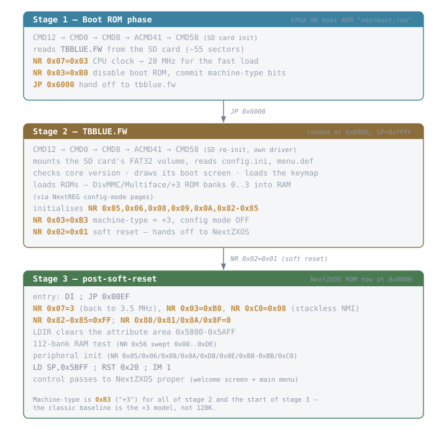

# ZX Spectrum Next boot sequence and firmware sourcing (reference)

Ground truth for `ti0.r0`/`ti0.r6` (T-32/T-36 and friends) on how a real
Next actually boots, so this work is checked against the hardware rather
than guessed. Nothing here is a zenzx design decision; it's reference
material for T-32 (NEX loading) and any future NextZXOS-boot work.

## 1. The boot sequence

Three stages, each handing off to the next via a NextREG-triggered soft
reset:

**The one fact most relevant to zenzx's own memory-model work:** the
machine presents itself as NextREG machine-type **`0xB3` -- "+3" -- not a
distinct "Next" personality**, for the whole of stage 2 and the start of
stage 3. NextZXOS's classic-compatible runtime is built on the **+3**
memory/ROM model (extended by NextREGs on top), not the 128K model. If
zenzx ever grows a closer-to-real Next boot path, `+3` is very likely the
correct classic baseline to layer `EnableNext()` on top of, not `128k` --
worth a follow-up once `-model=next`'s blank-screen bug (see the "Wire up
Next as a model" work, still open) is root-caused.

## 2. Z80N: always decoded, no enable step

On real hardware there's no runtime "enable Z80N" step: Z80N encodings
live entirely in `ED`-prefix slots a genuine (non-Next) Z80 leaves
undefined, and those execute as a harmless two-byte NOP on any machine
that isn't a Next. A Z80N-aware core can therefore decode the full Z80N
opcode set unconditionally, for every machine type, with zero behavioural
difference on 48K/128K/+3 -- real software for those machines never emits
those bytes, so there's no "correct" moment to switch decoding on. This is
architecturally simpler than zenzx's current design (`-z80n` as a
separate, explicit, CPU-only flag). Not a recommendation to change
zenzx's flag -- just worth knowing that there's no hidden hardware-timing
requirement to replicate here; the hardware itself doesn't have an enable
sequence at all.

## 3. Graphics mode at boot: plain classic ULA, nothing exotic

The TBBLUE.FW boot screen and the NextZXOS welcome/main menu both use
plain classic ULA text+attribute graphics -- the same 256x192
pixel/attribute layout a 48K Spectrum uses, rendered with a rainbow-stripe
logo and standard 8-colour attribute text. No Layer 2, no sprites, no
Copper, no exotic Next-only video mode is needed to reach or render the
boot menu -- those are opt-in per-application, not part of the boot chain
itself.

## 4. Where the firmware legally comes from

- **The FPGA boot ROM** (8K) is extracted from the official, open-source
  [ZX Spectrum Next FPGA core](https://gitlab.com/SpectrumNext/ZX_Spectrum_Next_FPGA)
  VHDL sources -- the Next project's own openly-published hardware
  description, not third-party copyrighted material.
- **Everything else** -- the classic 48K/128K/+3 BASIC ROMs, NextZXOS
  itself, the DivMMC and Multiface firmware -- lives on an **SD-card
  image**, at the canonical TBBlue paths under `/MACHINES/NEXT/`, and is
  never embedded in an emulator binary. The **official distribution** is
  published at `https://www.specnext.com/distro/24.11/sn-emulator-24.11.zip`
  -- **specnext.com, the official ZX Spectrum Next site** -- and that is
  where the bundled classic ROMs' licensing is actually settled, since
  SpecNext Ltd arranged the necessary rights when the Next was
  crowdfunded. TBBlue's own firmware sources are at
  [gitlab.com/thesmog358/tbblue](https://gitlab.com/thesmog358/tbblue).

**For zenzx specifically:** this SD-card model is a different shape from
zenzx's own current approach (classic ROMs committed into `rom/` and
embedded via `go:embed`, under the already-resolved permissions in
`rom/SINCLAIR.txt` and `rom/TIMEX.txt`) -- that existing arrangement is
settled and out of scope here. The one *new* question this raises is
narrower: if zenzx ever wants NextZXOS itself (for real `.nex`/SD-boot
support, beyond T-32's planned direct-injection shortcut), NextZXOS isn't
covered by `SINCLAIR.txt`/`TIMEX.txt` at all -- it would need sourcing
from the official specnext.com distribution, not bundled. T-32's own
scope (direct memory/Layer2/palette injection, no OS) was deliberately
chosen to sidestep exactly this, so it doesn't currently apply -- worth
keeping in mind only if that scope ever grows. Licensing/sourcing for
T-36 (the real boot chain, Tier 2) is being handled outside this
codebase track; see `TRACKING.md` for T-36's engineering scope only.

## 5. Primary references

- [ZX Spectrum Next FPGA core](https://gitlab.com/SpectrumNext/ZX_Spectrum_Next_FPGA)
  -- the authoritative VHDL hardware specification
- [TBBlue firmware sources](https://gitlab.com/thesmog358/tbblue) -- the
  official firmware sources for the boot chain in Section 1
- [specnext.com](https://www.specnext.com/) -- the official ZX Spectrum
  Next distribution site, source of the firmware in Section 4
- [ZX Next Wiki](https://wiki.specnext.dev/Main_Page) -- general Next
  development reference
