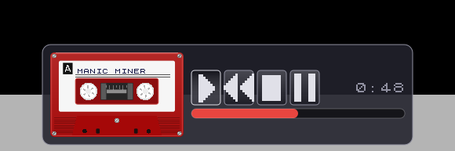

# The GUI

The window, its menu bar, the files that configure it, its keys and what can be dropped on it. The flags are in [`MANUAL.md`](MANUAL.md).

## Top menu bar

`-theme=Dark|Light|Spectrum` (default `Dark`, case-insensitive) sets
the theme active from the very first frame, without needing to open
the Theme menu first -- when `-theme` isn't given at all, the theme
last saved to `settings.json`
is used instead of this flag's own default (see **Configuring the
Machine menu and persisted preferences** below).

Hover the mouse pointer within 10px of the top window edge and hold it
perfectly still for 100ms -- a menu bar slides in (eased in, not linear)
with eight menus. Once the bar is shown, hovering any label opens its
dropdown immediately -- no click needed -- and moving to a different label
switches directly to it, the same as a traditional desktop menu bar once
any menu is already engaged.

The text of the bar itself is magnified to suit the window, and the bar's text is the one
thing the **Font zoom** setting does not touch (that is the size of the dropdowns' text). The
bar takes the greatest of X1, X2 and X3 that fits the window both ways: its labels, with a
blank space after each, take no more than 60% of the window's width (in the default
face, Spleen: X2 from a window 950 pixels wide and X3 from 1425; the faces differ in width, and
so do the thresholds), and the strip that holds the text
takes no more than an eighth of the window's height (X2 from 256 high, X3 from 384). It is
worked out afresh every frame, so it follows the window as it is resized. The text has room
above and below it, half its own height and never under 4 pixels, so the strip is 24 pixels
high at X1, 32 at X2 and 48 at X3; the Spectrum logo (the rainbow, in the Spectrum theme), its two buttons and the room
reserved at the top of a window with a fixed bar all follow the strip's height. The
dropdowns are not part of this: they stay at **Font zoom**.

A dropdown that is in groups opens each group with a small heading, as Help and Storage do:
**Machine** (Reset, Play, Pause, Stop, ahead of the makers' groups), **Playback**, **Mode** and **Information** (Tape),
**Save and Load** and **Information**, **Display**, **Scale** and **Layout**, **Theme** and **Text**,
and in Theme's Font submenu **Font** and **Zoom**. **File** is one group with Quit set apart, and
**Custom ROM** lists the ROMs there are, so neither has headings.

A window that closes (Help, About, Preferences, a file browser, the Export form, the question about files dropped on a Next and the rest) does not
vanish: for about a sixth of a second it fades out, over the picture and the bar, and shrinks a little
as it goes, its backdrop lightening with it. Nothing waits for it; the screen beneath is already the
live one.

- **File** -- the menu a person coming from another program looks for
  first, and the one a system with no application menu (Windows, most
  Linux desktops) has no other place to quit from.
  - **Open...** -- a file browser for anything the program loads: tapes
    (`.tap`, `.tzx`), snapshots (`.sna`, `.z80`, `.szx`, `.zxs`, and `.zms` multisnapshots), screens
    (`.scr`), disks (`.dsk`) and `.nex` files (which a Next runs, see "Running a
    .nex", below). What is chosen goes exactly
    where the same file dropped on the window would go (see "What a drop
    does", below), through the same code, so the two cannot differ; a file
    chosen here is a plain drop, with no Shift. The browser starts in the folder
    of the file opened last with it (the home folder when there is none, or when that folder has
    gone; never the folder ZenZX was run from), and **Load Disk...** of the Floppy Disk menu,
    the same browser for `.dsk` only, keeps a folder of its own. The name field is always being
    edited: type or paste a path (absolute, `~`, relative to the folder shown, with `..`, in quotes,
    or a `file://` address), and Enter opens the file or goes into the folder; **Tab** completes the
    name, and a pattern such as `*.tap` limits the list. The **file type** beside the field chooses
    all the Spectrum files, one medium's (tapes, snapshots, disks, recordings, screens, Next
    programs) or all files, and `Ctrl+Tab` goes to the next. **Recent**, first in the sidebar, lists
    the files opened last, of every medium (those opened here, and those dropped on the window), under
    the file type chosen; what has gone is left out. `Ctrl+H` shows the hidden files and `Ctrl+D`
    the details (size and date, with heads that sort). The recent files, the two folders and how a
    folder was looked at are kept in `settings.json` (`recentFiles`, `openFolder`, `diskFolder`,
    `fileDialog`); the tapes loaded last are kept apart from them (`recentTapes`, 60), for Tape > Recent Tapes. Every edit box takes `Ctrl+C`, `Ctrl+X` and `Ctrl+V` (`Cmd` on a Mac), and
    Save browsers ask before replacing a file.
  - **Export...** -- pauses the machine and opens a form that says what it does and asks for a name, with the folder shown and **Browse...** to change it; the
    file written is a program of one file, a copy of this ZenZX with the machine as it is now
    inside it, that opens a window and goes on from there on its own, with nothing else to carry
    (the 48K, 128K, +2, +2A, +3 and Spanish models; not the Next or the Timex machines).
  - **Preferences...** (with no separator above it: Open, Export and Preferences are one group, and Quit is set apart) -- a window with every choice the program keeps
    between sessions, in one place (below).
  - **Quit** -- ends the program the way closing its window does.
- **Machine** -- under the heading **Machine**, Reset; **Pause** or **Play** (the row says which, with its icon, for the machine in front);
  **Stop**, which ends the machine (a ground comes up with a bin and a small Spectrum on it, a leg comes down and a boot stamps the Spectrum flat, and the ground goes back down; then the machine is gone from the dock; with the last one gone the window is only its background and a small figure waiting on it (a blink, three taps of a foot, a look to its right, two blinks, with long rests between, and round), and **New** or a model from this menu starts one again); and every supported model,
  grouped by manufacturer under a small heading and separator each:
  **Sinclair Research Ltd** (the original 48k/128k), **Amstrad plc**
  (+2/+2A/+3), **En Español** (the Spanish-market variants -- which,
  unlike the other three groups, span three different manufacturers
  across their own history rather than one, so each model gets its
  own indented sub-heading naming its actual maker: **Sinclair**
  (48k, Sinclair's own design, distributed and locally assembled in
  Spain), **Investrónica** (128k, genuinely designed by Investrónica
  itself with Sinclair's permission, and launched in Spain months
  before the UK got it), and **Amstrad** (+2 and +3, the +2
  specifically the first computer launched under Amstrad's own
  ownership after its 1986 acquisition of Sinclair)), and **Timex**
  (the Timex Sinclair 2068) -- with a checkmark on whichever model is
  currently running. Picking a model switches the running machine
  live, without restarting: reloads the target's standard ROM set,
  resets, and resets the joystick to that
  model's own default.

  This grouping is entirely configurable, not hardcoded: it's loaded
  from `machines.json` at startup -- a file in the current directory
  if one exists and validates, otherwise the copy built into the
  binary (the layout described above). A hand-edited `machines.json`
  is validated against a schema (using
  [queryfy](https://github.com/ha1tch/queryfy)) before it's used; an
  invalid one is reported and skipped in favour of the built-in
  default, never treated as fatal. The file is a flat list of nodes:

  ```json
  {"type": "separator"}
  {"type": "title", "label": "Sinclair Research Ltd"}
  {"type": "model", "id": "48k", "label": "ZX Spectrum 48k"}
  {"type": "submenu", "label": "More", "items": [ ... ]}
  ```

  `separator` (a divider line), `title` (a small, non-selectable
  heading, `indent` optional), `model` (a selectable entry -- `id`
  must be one of the fixed `-model` identifiers the emulator actually
  supports, `indent` optional), and `submenu` (a hover-opened nested
  menu, capped at one level of nesting) can appear in any order and
  combination. `indent` adds two spaces of leading whitespace per
  level, purely visual. What can't change is *which* models exist:
  every one of the emulator's supported `-model` identifiers must
  appear exactly once across the whole file -- rearrange, retitle,
  and regroup freely, but nothing can go missing or get duplicated.
- **Custom ROM** -- pick a file from `-custom-roms-dir` and apply it
  live (same two-step ROM-then-bank flow as `-custom-roms-menu`, for
  models with more than one bank). The folders of the directory are submenus, two levels down (a
  folder's own ROMs, then those of its folders, as `folder/x.rom`), ahead of its own ROMs; when the
  window has not the height for them, the rest goes under **More...**. After the ROMs, a separator and **Download more ROMs**, a
  submenu that opens, in the browser, the pages where ROMs are published: those listed in
  `custom-roms/rom-archives.json` (Rodolfo Guerra's ROM mods and the Speccy4ever ROM archive, as shipped),
  or those two when the file is not there. It works with no machine running.
- **Tape** -- under the heading **Load**, **Load Tape...** (a file browser for tapes, which starts in the folder of the last tape loaded, or in `tapes/`), **Recent Tapes** (the last tapes loaded, newest first; with more than 15 a last row opens the window), **Manage Tapes...** (a window of the tapes in the `tapes/` folder and those loaded from elsewhere, each with the first screen on the tape; the blocks of the one that has the focus are listed under it; Load, Rename and Delete) and the **Autoload Tape** checkbox (the setting of Preferences > Machines > Autoload tape); under the heading **Playback**, **Play**, **Stop** and **Rewind**, each with its
  button (the sprites the Machine menu and the tape deck have); under **Mode**, **Accurate** and **Fast** as radio
  buttons (a ring, with a dot in the one that is chosen; Turbo, chosen with `-tapemode turbo`, shows as Accurate,
  and both are greyed with no tape); and under **Information**, **Tape
  Info**, which opens a window with the tape's file, mode, state and
  blocks. Play is greyed with no tape loaded or while it plays, Stop while it does not, and Rewind with no tape loaded -- Play, Stop and Rewind are the same
  actions as the `Alt+P/R/T` shortcuts, `Alt+P` playing and stopping with one key (`Alt+I` opens the tape's window, as Tape Info does). The
  **tape deck** (Preferences > Machines > Tape) shows the tape playing, with the same
  controls as buttons, while a tape loads in Accurate mode:

  

  The deck does not have to stay: with the pointer over it, the **mouse wheel** steps it from a
  big cassette to a small one, to no cassette, to the **chip** (a mini cassette, a play button,
  the counter and a cross, at the right end of the strip), and back; the small **-** and **x**
  beside its counter make it the chip or send it away; a click on the chip makes it full; and
  **dragging** it carries it about the window, and when it is let go it settles, gliding, at the top
  or the bottom, whichever its middle is nearer. It does not jump from one form to another: going
  from big to small, from the deck to the chip, or from one edge to the other, its parts move to
  their new places and the ones the new form has not shrink away, easing in and out as the dock's
  slide does, and a deck that comes on or is sent away slides in from, or out to, its edge. A
  deck that is not running turns into the chip by itself after six seconds; when the tape has
  played to its end the deck stays four seconds more and then slides out towards its edge, as the
  dock does; and one that is the
  chip or away comes back when the tape is set going or another is loaded. The size and the
  place are saved as the Preferences' Cassette and Tape deck.
- **Storage** -- the same two sections, Floppy Disk and then SD Card, on
  every model, so the menu does not change shape when the machine does. A
  section is live where the machine has that hardware; where it has not,
  it stays, greyed, with one line, N/A (no drive on a 48K, 128K,
  +2 or +2A, no card slots outside a Next, a +3 started with `-nofdc`).
  The result of a choice -- a disk loaded, a card inserted, "there is no
  disk in the drive" -- shows as a toast at the corner of the window as
  well as in the terminal, for those who never look at the terminal.
  - **Floppy Disk** (+3 and Spanish +3) -- **Load Disk...** (a live
    file browser), **Recent Disks** (the disks loaded lately, newest first; with more than 15 a
    last row opens the window) and **Manage Disks...** (the Floppy Disks window: the disk
    in memory against its file, and the folder's disk images), then Insert Blank Disk, Save Disk,
    Save Disk As... and Eject Disk, and **Disk Info**, which opens a window with the disk's file,
    its format, whether it has unsaved changes and whether the file has changed
    on disk since it was loaded. The rest are the same actions as
    `F4`-`F8`. See "The +3's disks" in the manual. On a Next the section is greyed signposts
    for the NextZXOS drives A: and B:, which ZenZX does not emulate yet
    (T-72).
  - **SD Card** (a Next that boots NextZXOS) -- the cards in the Next's two
    slots, and the second one changed: **Insert Card in Slot 2...** and
    **Manage Cards...**, the SD Cards window: every card image, who has it, booting from another,
    copying, renaming and deleting (each asks first); then **Insert ZenZX's Card (Examples)**,
    **Remove Card from Slot 2**, **New Empty Card** (280 MB or 1 GB) and **Card Info** (a window
    with each slot's file, size, whether it is write-protected, how much it holds and
    whether it boots a Next). See "The
    second card" in the manual.
- **Snapshot** -- under the heading **Load**, **Load Snapshot...** (a file browser for any snapshot), **Recent Snapshots**
  (the named ones saved or loaded, newest first, fifteen at most) and **Manage Snapshots...** (a window that loads, duplicates, renames and deletes
  the snapshots, multisnapshots too, in the folder, `snapshots/`, that every snapshot is saved into); under **Save and Load**, Quick Save/Load, Save Timestamped, **Load Timestamped** (the ten newest
  timestamped snapshots, and **More...** for the rest, grouped by day, week and month when there are
  many), **Save As**, **Save Multisnapshot...** (for two machines
  or more: a snapshot of each, with the layout of the window, in one `.zms` zip) and **Load Multisnapshot...**
  (which closes the machines running and replaces them, after the window asks for the word `YES`; a Next's
  snapshot or one holding Nexts looks for the cards they were made over, and names the ones it cannot
  find so that you can choose them),
  **Load Binary...** (a
  window of three tabs: load a file into memory at an address, in the memory as the CPU sees it or in
  a RAM page of a 128K or a Next, in boxes that take only what can be used; peek and poke; and **Hot Memory**, a hex editor, typed in as hex or as ASCII, over the running
  machine with a list of the CPU's 64K and of the machine's RAM pages), **Snapshot Info** (a
  window that lists the snapshot files there are and says how snapshots are loaded and saved; with no machine running the rows that save or look into one are greyed, and Quick Load, Load Timestamped and Manage Snapshots make the machine each snapshot is of),
  **Run Diagnostics** (a scrollable report on the machine as it is, also on `F3`; a Next's has its hardware in three more sections) --
  the same actions as `F9`, `F10`, `Shift+F11` and `F12`, except Save As. **Save As** is a submenu of the
  formats ZenZX writes, **ZenZX snapshot (.zxs)**, **SNA (.sna)** and **Z80 (.z80)**; a
  choice opens a file browser, in the folder ZenZX runs in, that shows the files of that
  format and takes the name (the format's extension is added when the name has none). The
  result of every item of this menu, saved or refused, shows as a toast. `.szx` and `.rzx`
  are read and not written, so they are not on the list.
- **View** -- **FPS Counter**, **Border** and **Full Screen** are checkboxes,
  showing current on/off state directly (wired to the display
  manager's own fields, so it's always correct whether last changed
  from here or via `Alt+F`/`Alt+B`/`Alt+Enter`). Clicking the FPS counter keeps the menu
  open; Border and Full Screen change the size of the window the menu hangs from, so
  choosing one closes the menu. The border is the
  user's to choose only where nothing else decides it: in a tiled layout
  every machine is shown with its border, in a Layer 2 mode that fills the
  whole 320x256 frame (the 320x256 and 640x256 modes) the border is part of
  the picture, and in a mode with no border there is nothing to show. There
  **Border** is greyed and shows what is on the screen, `Alt+B`
  says why it does nothing, and the choice already made is kept for when
  the machine is back where it applies. The window's size follows the
  border however it came to change. **Full Screen** (`Alt+Enter`) puts
  the window, without its border, over the whole of the monitor it is on, at the mode the
  monitor already has, so the desktop does not change its resolution; checked while it
  is so. Windows has no full screen for a program that does not make one, and this is it; on
  macOS and Linux it is the same, beside the window manager's own. The picture is fitted
  to the screen at the largest whole zoom that fits (up to X 5) and put in the middle of the
  frame, a tiled layout fills it, and leaving brings the window back to the size and the zoom
  it had; the zoom you chose is not changed by it, nor saved from it, and **X 1**/**X 2**/**X 3** and
  `PgUp`/`PgDn` do nothing meanwhile. Below a separator, **X 1**/**X
  2**/**X 3** set the emulated display's own scale directly (the same
  scale `PgUp`/`PgDn` step through one at a time), with a checkmark on
  the current one and any scale too large for the current monitor
  disabled -- refreshed every frame the bar is shown, since the scale
  can change outside the menu entirely. Below another separator, the
  layouts for several machines: **One Machine**, **Side by Side**,
  **Stacked**, **Grid**, **Stack Left, Main Right**, **Main Left, Stack
  Right**; the scale items are greyed in a tiled one. Where the window is larger than the
  picture and the picture is centred in it, what is round it is a gradient from 80% grey at
  the top to 90% grey at the bottom, crossed by five faint beveled lines at regular intervals, and the
  picture has a soft drop shadow on it. A window that is enlarged or maximised stays as it was
  made: the picture takes the largest whole zoom that fits and goes in the middle. (`ZENZX_WINDOW_DEBUG=1`
  prints what the window reports, one line for each change, for finding out why one is not
  framed.) **Rotate
  Machines** moves each machine to the next place. See "Several
  machines" in the manual. Below one more separator, **Screenshot**: **Save as PNG**, **Save as SCR**
  and the other formats the picture on the machine can be saved in (greyed where they do not apply), **Save as GIF (2 seconds)**,
  and **Manage Screenshots...**, a window that lists the files of the `screenshots/` folder with a thumbnail
  of each and previews, renames and deletes them; see "Screenshots (GUI)" in the manual.
- **Theme** -- switch the bar's (and every dropdown's) colour scheme
  live, with a checkmark on the current selection: **Dark** (the
  default) and **Light** (a macOS Aqua-inspired scheme) both show the
  Zen Spectrum Project's own logo on the right side of the bar, space
  permitting -- four ascending three-block "teeth", drawn as filled
  rectangles (not a bitmap), each in a random pastel colour of the
  Spectrum's eight (black is a light grey); the four hold still for a
  second and then fade together, over half a second, to another four; every ten
  fours, the Spectrum's own (red, yellow, green, cyan) is shown instead, for three seconds.
  **Spectrum** (the
  real Sinclair 128K/+2/+3 boot menu's own palette -- white panel,
  black text, bright cyan selection in the dropdown, grey separators,
  a darker standard-brightness green checkmark, and a fixed blue for
  checkboxes; a vertical gradient bar background (40% grey at the top
  to black at the bottom) with a second, horizontal gradient layered
  on top in multiply blend mode over the rainbow's own region --
  white at that region's left edge fading to black at the window's
  right edge, darkening the background there without affecting the
  rainbow itself, drawn on top of it; a 2px border with no top edge on
  the dropdown, since it always opens directly under the bar; tight
  item spacing plus extra bottom margin below the last row, matching
  the real menu's own compact rows) shows that title strip's own
  four-band diagonal rainbow instead, in the same bar slot -- red/
  yellow/green/cyan, measured pixel-by-pixel from an actual boot
  screenshot and independently confirmed against a purpose-built
  reference asset, drawn as adjacent 1px scanline segments (not a
  bitmap, and not lines -- filled rects, since raylib's own line
  drawing left a 1px gap between bands), whenever there's enough room
  for it. Below a separator, **Font** opens as its own submenu:
  switch the bar's (and every dropdown's) typeface live, with a
  checkmark on the current selection, among the bundled BDF faces --
  **Spleen** (the default), **Sinclair** (the ZX Spectrum 48K ROM's
  own 8x8 character set), **TomThumb**, **Cozette**, **Creep**,
  and **HaxorMedium** -- then, below its own separator, **Zoom X1**/
  **X2**/**X3** (likewise checkmarked; unlike the font choice itself,
  this magnification factor applies only to dropdown text and layout,
  never the bar strip, which always draws at X1 regardless). X2 is
  the default, matching the size dropdowns have always drawn at.

The Help menu is opened by the button at the right end of the bar, a thin circle with three thin lines in it
(the "burger"). Like the toolbar button at the left end, it is drawn in the theme's text colour: a light
edge at rest, a faint face under the pointer and a darker one while the menu is open, and the pointer is
a hand over it. Click it directly, no hover needed; the menu is right-aligned to the button's right edge (moved a little
left where its submenu needs the room). It is in titled sections:

- **Help**
  - **Help** -- a scrollable reference covering every menu, keyboard
    shortcut, and command-line flag.
  - **ZenZX Manual** -- the manual as a PDF, in the reader the system has for PDFs. The
    file is `zenzx-<version>-manual.pdf` (the release carries it): the one beside the program
    (its folder, the folder above it, or a `docs` folder in either, or the folder the program
    was started from) is opened, and without one the release's copy on GitHub is, in the
    browser (a build between releases opens the releases page). The row needs no machine.
  - **About...** -- version, project link, and licence/attribution, and a
    pointer to the acknowledgements.
  - **Acknowledgements...** -- the people the project owes thanks to. It
    shows `ACKNOWLEDGEMENTS.md`, the file in the source tree, so there is
    one text of it; `https://github.com/ha1tch/zenzx/blob/main/ACKNOWLEDGEMENTS.md`
    is where to read it on GitHub. Its links, and the addresses in **About**
    and **Help**, are clickable: a click opens the page in the default
    browser, and the pointer is a hand over one. The windows that show what
    a file says about itself (Tape Info, Disk Info) have no links.
  - **ZenZX website** -- opens the project's own page
    (`https://ha1tch.github.io/zsp/projects/zenzx`) in the default
    browser.
- **Tools**
  - **Developer** ▸ **Debugger** -- opens the debugger (`Alt+D`) on the
    front machine; in a window of several machines it hides the dock, which
    the debugger cannot share the window with.

### File > Preferences...

One window for the choices the program keeps between sessions, in titled
sections. Each row reads its value afresh every frame and changes it through
the same code the menu that sets it uses, so the window and the menus cannot
disagree, and a change is written to `settings.json` as it is made.

The pointer is a hand over the tabs. A row's help text (what its label cannot say, or why it
cannot be changed now) is hidden until the pointer rests for a moment on the row's caption or on
its control, and shows in a box under it; resting on a group's title shows the help of every row
in the group. The box goes when the pointer moves off, and after a click until it has.

| Section | Row | What it does |
|---------|-----|--------------|
| Appearance | **Theme** | Dark, Light or Spectrum (the Theme menu) |
| Appearance | **Font** | The bundled faces (Theme > Font) |
| Appearance | **Font zoom** | X1-X3, the size of the dropdown menus' text (the bar's own text is fitted to the window, see Top menu bar) |
| Window | **Display zoom** | X1-X3 (the View menu's X 1-X 3); greyed while machines are tiled, and a size that does not fit the monitor or the video mode is refused as the View menu disables it |
| Window | **Fixed menu bar** | Pins the bar permanently shown, bypassing the idle-at-edge auto-hide until unchecked -- the window grows taller to make room (animated, as toggling the border animates a resize) rather than overlapping the display, and shrinks back when unfixed. The space is reserved exactly while the bar is fixed, checked every frame, so a bar saved as fixed has its space from the first frame |
| Machines | **Machine dock** | Whether the dock may slide up from the bottom edge (and with `Alt+M`). Off, it stays away, and one that is open closes. On by default |
| Machines | **Stop animation** | Whether stopping a machine (Machine > Stop) plays the animation of a boot coming down and stamping a small Spectrum flat. Off, the machine goes at once. On by default; `"stopAnimation"` in `settings.json` |
| Machines | **Autoload tape** | (Also a checkbox on the Tape menu.) Whether a tape that File > Open, Tape > Load Tape, a drop or `-tape` has put in the deck starts by itself: the machine is reset and types what loads it on its own ROM (`LOAD ""`, or the Tape Loader of a 128K), then the tape plays. Off, the tape waits and the toast says what to type. Not on a Next or with a custom ROM. On by default; `"tapeAutoload"` in `settings.json` |
| Machines | **A loaded snapshot** | What a `.zxs`, `.sna`, `.z80` or `.szx` (and the machines of a `.zms`) does once it is loaded by File > Open or a drop: **Waits paused**, for Play or `F2`, or **Plays at once**. Quick Load (which always waits paused) and `-snapshot` are not affected. The machine is the one the snapshot is of: see the manual, Snapshots in the GUI. Waits paused by default |
| Machines | **Tape deck** | A cassette, a progress bar, a counter and the buttons **Play, Rewind, Stop, Pause** while a tape loads in Accurate (or Turbo) mode: **Off**, **Top** or **Bottom**, in that part of the border, or over the picture near its top or bottom when there is no border or it is thin (X1). The first program's name is written on the cassette's label, and every new tape is a cassette of another colour of twelve. Top by default; not shown in Fast mode or while the machines are tiled (T-88) |
| Machines | **Cassette** | The size of the tape deck's cassette: **Small**, beside the buttons; **Big**, under the buttons and the bar, over the picture, with the first program's name written large on its label; or **Hidden**, leaving the buttons, the bar and the counter. Big by default |
| Machines | **Language switch** | The diode of the Microdigital clones (the TK90X and TK95) that picked the language of their messages: **Spanish** (the default) leaves bit 7 of the ULA port high, as it reads on every other Spectrum, and **Portuguese** reads it low. A Microdigital ROM that reads it before it shows a message (the `TK90X-pt-BR.rom` of `custom-roms/` does) answers in that language; a ROM that does not is not moved. It applies to the 48K models only (the 48K and the Spanish 48K): the Amstrad models (128K, +2, +2A, +3), the Timex and the Next read the port as they always did. `-language-switch` sets it for one run and is not saved; choosing the row ends its say |
| Machines | **Several machines** | Whether the dock's **New** tile may add machines. Off, the tile is greyed and says so when used. Machines that `-multi` starts at launch are not affected. On by default |
| Files dropped on a Next at its menu | **A plain drop** | What a tape, screen or snapshot dropped on a Next sitting at its NextZXOS menu or Browser is done with: **Ask**, **Copy to SD card** or **Load and run**. Ask by default |
| Files dropped on a Next at its menu | **With Shift held** | The same, when Shift is down as the file is let go. Load and run by default |
| Keyboard | **Escape** | What Escape does when no menu or window is open for it to close: **Disabled** (it never quits, and leaves the debugger open), **Closes windows only** (it also closes the debugger), **Asks before quitting** (a second press within a moment quits) or **Quits at once**. Disabled by default, including for a settings file from before the choice existed. `-escape` sets it for one run and is not saved; choosing a row ends its say |

Border and the FPS counter are deliberately not here: they are session
diagnostics, kept in the View menu, and (as the settings file's own rule says) not
saved. Sound is a command-line choice (`-no-audio`) and is not in the window.

The bar shows one thing at a time: a window or dialog has the frame to
itself, and opening the Help menu closes any dropdown that was open. That
rule is kept in one place, applied every frame, and not left to each way of
opening a menu to remember. Likewise each menu is written once, as a table
of rows that carries each row's label, state and action, and the items the
bar draws and the actions it runs are both made from it, so a row cannot be
given another row's action.

The emulator keeps running the whole time -- CPU stepping and the
Spectrum's own screen never pause while the bar or a dropdown is open.
Only keyboard input to the emulated machine is withheld while a
dropdown, dialog, the logo menu, or a modal is actually open -- the
bar being merely shown (or fixed) never withholds it by itself. Move
the mouse away from the bar (with nothing open, and not fixed) and it
slides back out the same way it came in.

The bar itself (`zenui.MenuBar`) and every dropdown it opens
(`zenui.Menu`) are general, renderer-agnostic components of
[zenui](https://github.com/ha1tch/zenui), the toolkit ZenZX shares with
zenimate and zenplay -- reusable by any host, not specific to this menu's
contents or to raylib. The Help and About window (`zenui.TextModal`) and
the progress bar of the Next's first-start dialog are zenui's too.

## Configuring the Machine menu (`machines.json`) and persisted preferences (`settings.json`)

The Machine menu's own layout -- which models exist, how they're
grouped, and under what headings -- comes from `machines.json`, not a
hardcoded list. A copy is bundled into the binary as the default; a
valid `machines.json` next to the executable overrides it entirely (an
invalid one is reported and the built-in default is used instead,
rather than treated as fatal). The file is a flat list of nodes:

```json
{"type": "separator"}
{"type": "title", "label": "Sinclair Research Ltd"}
{"type": "model", "id": "48k", "label": "ZX Spectrum 48k"}
{"type": "submenu", "label": "Amstrad plc", "items": [ ... ]}
```

- **`separator`** -- a thin divider line.
- **`title`** -- a small, non-selectable heading; `indent` (default 0)
  adds two spaces per level, for a sub-heading within a group.
- **`model`** -- a selectable entry. `id` must be one of the fixed
  `-model` identifiers (`48k`, `128k`, `plus2`, `plus2a`, `plus3`,
  `spanish48k`, `spanish128k`, `spanishplus2`, `spanishplus3`,
  `ts2068`) -- the file controls how models are presented and grouped,
  never which models exist, and every one of them must appear exactly
  once across the whole file.
- **`submenu`** -- a hover-opened nested menu, holding its own list of
  `separator`/`title`/`model` nodes (not a further `submenu` -- one
  level of nesting is the limit the menu bar's own selection reporting
  can express).

Groups, titles, and separators can be arranged in any order and
combined freely; `machines.json` at the project root is the actual
default configuration and the clearest example. Validated against a
[queryfy](https://github.com/ha1tch/queryfy) schema (`pkg/machineconfig`)
before use.

Theme, font, font zoom, display scale, whether the menu bar is
pinned shown, whether it shows the toolbar and not the menus (`"toolbar"`: a boolean, off when absent), whether the machine dock and adding machines are allowed
(`"dock"`, `"multi"`, `"stopAnimation"`, `"tapeAutoload"`: booleans, on when absent), and what a plain drop and a
Shift drop do on a Next at its menu (`"drop"`, `"dropShift"`: `"ask"`,
`"copy"` or `"run"`; absent they are `"ask"` and `"run"`), and where the tape deck goes
(`"tapeDeck"`: `"off"`, `"top"` or `"bottom"`; absent it is `"top"`) and its cassette's size (`"tapeCassette"`:
`"small"`, `"big"` or `"hidden"`; absent it is `"big"`) and what the Escape key does (`"escape"`: `"off"`,
`"close"`, `"query"` or `"on"`; absent it is `"off"`) and where the Microdigital language switch stands
(`"microdigital"`: `"spanish"` or `"portuguese"`; absent it is `"spanish"`) are saved to
`settings.json` (`pkg/settingsconfig`, same
embedded-default-with-disk-override pattern, also queryfy-validated)
every time one of them changes via a menu, so the next launch resumes
where the last session left off. `-settings=PATH` points at a
different file instead of the default `settings.json`. An explicitly
passed `-theme` or `-scale` flag always wins over whatever's
persisted; leave either unset and the persisted value is used instead
of that flag's own hardcoded default. The running `-model` and FPS/
border visibility are deliberately not persisted -- an explicit model
should never be silently overridden by a stale save, and FPS/border
are session-level diagnostic toggles, not the kind of preference most
applications carry across restarts.

A `settings.json` that is empty, `{}` or `null` is recreated from the embedded default and used
(a note is printed); one with some of the keys has the rest filled in from the default in memory
and is left as it is; one that is not usable is moved aside to `settings.json.bad`, the default is
used and the file is made again, with a warning. Nothing about the file stops the program from
starting, and a folder that cannot be written to only adds a warning.

## Runtime keyboard shortcuts (GUI)

While the emulator is running, these host keys control it. They are intercepted
by ZenZX and are not passed to the guest.

| Key | Action |
|-----|--------|
| `Esc` | Close the open menu or window. With none open it does nothing, unless Preferences > Keyboard > Escape (or `-escape` for one run) makes it close the debugger, ask before quitting, or quit |
| `F1` | Reset the machine |
| `F2` | Pause / resume (a paused machine shows a Play button in the middle of its picture; clicking it resumes) |
| `F3` | Open the diagnostics report in a window (Snapshot > Run Diagnostics) |
| `F4` | Save the current disk image (+3, if modified) |
| `F5` | Insert a blank disk (+3) |
| `F6` | Eject the disk (+3) |
| `F7` | Say how to load a disk (drop a `.dsk` on the window, or `-disk=`) |
| `F8` | Save the disk image to a new file (+3) |
| `F9` | Quick-save snapshot (into the snapshots folder, `snapshots/`) |
| `F10` | Quick-load snapshot (the machine it is of is made when it is not the one that is shown, and with no machine running) |
| `F11` | Full screen on and off (the same as `Alt+Enter`; it was the timestamped snapshot until 0.50.0, which is now `Shift+F11`) |
| `Shift+F11` | Save a timestamped snapshot |
| `F12` | Snapshot info window; `Shift+F12` opens the diagnostics window, as `F3` does |
| `Shift+F1` | Show a demo dropdown menu, live over the running emulator |
| `Shift+F2` | Play a demo animated notification, live over the running emulator |
| `Shift+F3` | Show a demo file-open dialog, live over the running emulator |
| `Page Up` | Increase window scale |
| `Page Down` | Decrease window scale |
| `Alt+F` | Toggle the FPS counter (off at start; drawn in the interface font) |
| `Alt+B` | Toggle the border (where it is the user's to choose: not in a tiled layout or a full-frame Layer 2 mode) |
| `Alt+Enter` | Full screen on and off (View > Full Screen), as `F11` |
| `Alt+P` | Play / stop the tape |
| `Alt+R` | Rewind the tape |
| `Alt+T` | Toggle tape mode (accurate / fast) |
| `Alt+I` | Tape info window: status and block list |
| `Alt+M` | Open or close the machine dock |
| `Alt+1`..`Alt+9` | With several machines (`-multi`), bring that machine to the front: the display, sound and keyboard pass to it, the same as clicking its tile. A digit past the number of machines does nothing. |

## Drag and drop

In the GUI build, dropping a file onto the window loads it into the machine by
its extension:

| Extension | Loads as |
|-----------|----------|
| `.scr` | A raw 6912-byte screen dump, written straight onto the framebuffer (6144 bytes of bitmap + 768 bytes of attributes). This only paints the screen — it does not change CPU state or memory, so it is a still image, not a running program. |
| `.zxs` | A ZenZX snapshot (the proprietary chunk format). |
| `.tap` / `.tzx` | A tape image (loaded, then driven with the `Alt+P/R/T/I` controls). |
| `.dsk` | A +3 disk image. On a +3 it is mounted in Drive A (requires the FDC). On a Next, real NextZXOS can mount disk images as its own drives, but ZenZX does not emulate that yet (T-72), so a dropped `.dsk` is copied to the SD card instead (see the per-machine matrix below). |
| `.sna` / `.z80` | Standard snapshots (48K and 128K), via the shared `zentools` library. |
| `.szx` | ZX-State snapshots, load only, via the shared `zentools` library. |
| `.zms` | A multisnapshot: the snapshots of several machines and the layout of the window. Loading one closes the machines running and replaces them, after the window asks for `YES`. |
| `.nex` | A Next executable. It is not applicable to the classic models — only a Next can run it. On a Next that boots NextZXOS it is run by NextZXOS's own `.nexload`, started for the person (see "Running a .nex", below); it can also be copied to the SD card. |

A `.scr` can also be loaded headlessly with `-scr` (see above).

### What a drop does, per machine and per file type

The same drop is routed differently depending on the machine and, for a Next,
whether it is sitting at its NextZXOS menu or Browser (an *idle prompt*). The
default — dropping on the machine's screen — behaves as follows:

| File | 48K / 128K / +2 | +3 (with drive) | Next (running a program) | Next (at menu / Browser) |
|------|-----------------|-----------------|--------------------------|--------------------------|
| `.tap` / `.tzx` | load tape | load tape | load tape | **ask**: copy to SD card, or load and run |
| `.scr` | paint screen | paint screen | paint screen | **ask**: copy to SD card, or load and run |
| `.sna` / `.z80` / `.szx` / `.zxs` | restore snapshot | restore snapshot | restore snapshot | **ask**: copy to SD card, or load and run |
| `.dsk` | needs a +3 (toast) | mount & boot (RUN) | needs a +3 (toast) | **copy to SD card** (no prompt — ZenZX does not mount Next disk images yet, T-72) |
| `.nex` | not applicable (toast) | not applicable (toast) | **run** — after a question: the Next is busy, reset it and run it? | **ask**: copy to SD card, or run it |
| anything else | copied to a card/disk if one is present (see below), else ignored | as 48K | as 48K | as 48K |

The **ask** cases open a small dialog over the running machine with two buttons,
*Copy to SD Card* and *Load and Run*. Holding **Shift** at the drop is, by default,
the same as pressing *Load and Run*: it skips the dialog and runs the file at once
(so a quick "just run it" needs no click). Both halves are preferences
(File > Preferences..., "Files dropped on a Next at its menu"): what a plain drop does
-- **Ask** (the default), **Copy to SD card** or **Load and run** -- and what a drop
with Shift held does (**Load and run** by default; **Ask** and **Copy** are the other
two), so the modifier can be made to mean whichever is wanted. The choice applies to
tapes, screens, snapshots and `.nex` files, the files that have both outcomes; a `.dsk`
has only one on a Next, so it is copied whatever is chosen. The dialog's *Copy to SD Card*
goes to the slot the files were dropped on, not to whichever is under the button.
All of it is decided in one place, `planDrop`, for a drop on the window and for
File > Open alike. For a disk, "run" means mount and boot it: on a +3
that is Drive A, and real NextZXOS mounts disk images as its own drives, but ZenZX
does not emulate that for the Next yet (T-72) — so for now a `.dsk` dropped on a
Next has no run outcome and is copied to the card with no dialog, Shift or not. A
drop that mixes one with a tape copies it and asks about the tape.

### Running a .nex

A NEX is loaded by NextZXOS's `.nexload` and nothing else in the machine does it, so
"run" is what a person does at the keyboard, done for them, by the least invasive way
that works (`nexrun.go`; the guard is G-12):

1. **At the welcome screen, the menu or the Browser** — nothing is reset. The file goes
   on the second SD card, which NextZXOS calls D: (an empty slot gets a scratch card
   made in a temporary folder; a card that can be written is added to; a read-only one
   is replaced by the scratch card, which is said). The Browser is made to look at the
   cards again (its M then Y), and the keys that go from the menu to the command line,
   `cd "d:"` and `.nexload NAME` are pressed one at a time, frame by frame, the screen
   being looked at between them to know which screen the keys are meeting. It takes
   about twenty-five seconds, most of it the Browser reading the cards.
2. **While a program is running, or at the command line** — the Next may be in the
   middle of a game, and the menu cannot be reached from there by a key that is known
   to work, so a dialog asks whether the Next may be reset. When it is, the file is put
   on the card first, so NextZXOS sees the card as it starts, the machine is reset and
   the keys of 1 are pressed from the welcome screen. *Cancel* changes nothing.
3. **When neither works** (a menu the keys do not recognise, the command failing) — the
   Next is started again from a scratch boot card: the system's boot files, `.nexload`,
   the NEX and an `autoexec.bas` of one line that runs it. It takes the place of the
   card the Next started from until the card is changed back in the **SD Card** menu.

A version 1.3 NEX is refused, as NextZXOS's `.nexload` does not load it. How a run
ended is said by a toast.

### Dropping onto a storage slot

Dropping a file **onto a storage slot** copies it into that slot's media rather
than loading it into the machine, whatever the file type. While a file is dragged
over the window a slot drawer slides down from the top edge, with a rounded tile
per writable slot (the same look as the machine dock); dropping onto a tile adds
the file there:

| Slot | A dropped file is |
|------|-------------------|
| SD slot 2 (a Next's second card) | copied onto the card's FAT filesystem, and the Browser is refreshed so it shows at once, with no keypress |
| +3 Drive A (a disk in the drive) | written into the disk's +3DOS filesystem; it is seen on the next directory access (a `CAT` or a loader) |

With several machines the drop goes to the focused one's slot. A slot that cannot
take a file (read-only, or an empty drive) is shown dimmed with the reason, and a
drop onto it is refused with a toast.

## Spectrum keyboard mapping

Host keys are mapped to the Spectrum keyboard during emulation. Letters and
digits map directly. The composite and symbol keys are:

| Host key | Spectrum |
|----------|----------|
| `Shift` | CAPS SHIFT |
| `Ctrl` | SYMBOL SHIFT |
| `Tab` | EXTEND MODE (CAPS SHIFT + SYMBOL SHIFT) |
| `` ` `` (backtick) | EDIT (CAPS SHIFT + 1) |
| `Caps Lock` | CAPS LOCK (CAPS SHIFT + 2) |
| `Backspace` / `Delete` | DELETE (CAPS SHIFT + 0) |
| Arrow keys | CAPS SHIFT + 5/6/7/8 (left/down/up/right) |
| `,` `.` `;` `'` `/` `-` `=` `[` `]` | SYMBOL SHIFT + the matching Spectrum symbol |

(The headless build has no input; these apply to the GUI build only.)
