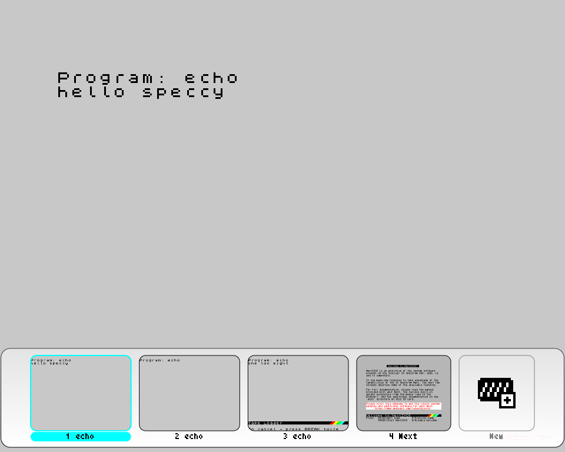
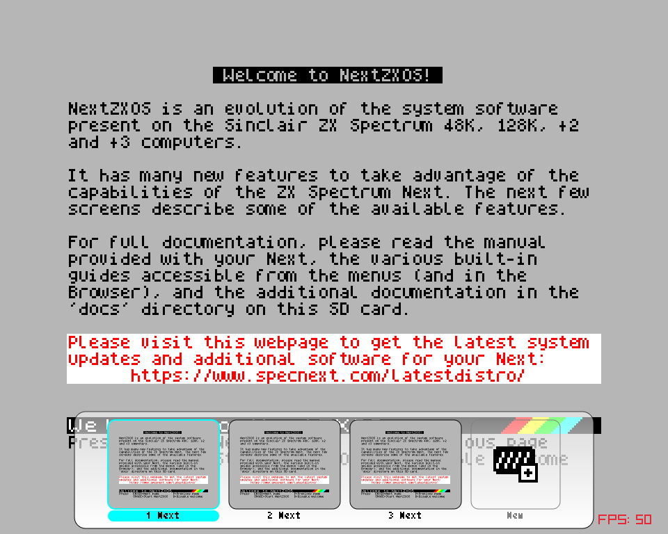
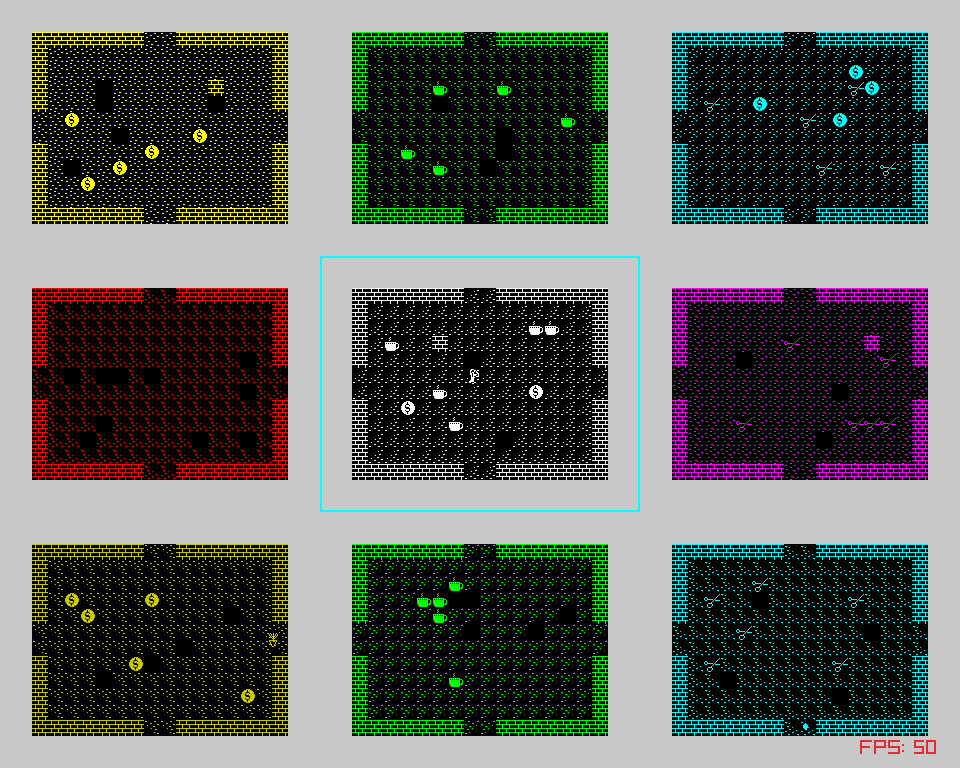

# The link, several machines, and autorun

Three options that go together: start several machines at once, give each
a socket through which a program outside can exchange bytes with a program
on the machine, and load that program from a text file.

```bash
zenzx -multi 4:48k,48k,128k,next -listen 16384,16385,16386,16387 -autorun examples/link/echo.bas
```



All three work in the GUI (`zenzx`) and in the headless program
(`zenzx-headless`).

## Several machines: `-multi`

| Written | Means |
|---|---|
| `-multi 12,128k` | twelve 128Ks |
| `-multi 4:48k,48k,128k,next` | four machines, a model each |
| `-multi 48k,128k` | a list alone: two machines |
| `-multi 3` | three of `-model` |
| `-multi 3:next/sdcard-01,next/sdcard-02,next/sdcard-03` | three Nexts, each booting from its own SD card |

The most is 32. In the GUI they are the machines of the dock (see "Several
machines" in the [manual](MANUAL.md)), in the order given, the first in
front. The View menu tiles them, and `-layout` tiles them at the start
without it: `-layout grid`, or `single` (the default), `columns`, `rows`,
`main-left` or `main-right`. In the headless program they run side by side
and a screenshot of each is written, named `<prefix>-m<N>-frame<F>.png`.

`-tape`, `-snapshot`, `-script`, `-disk` and the other options that concern
one machine go to the first machine. If any of the machines is a Next they
go to a Next instead, wherever it is in the list, because that is the
machine the options about a Next's boot files are for: the Next with no
card named, or the first Next if each has its own.

### Several Nexts

Two machines cannot boot from one SD card: each would be writing to a card
the other believes is its own. So a Next in the list may name its card
after a slash, and every Next but one must:

```bash
zenzx -multi 3:next/sdcard-01,next/sdcard-02,next/sdcard-03
zenzx -multi 4:48k,next/sdcard-01,128k,next
```



In the second line the last Next boots from the standard card, as a Next
on its own does. A card's name is looked for as written and with `.img`
added, first from where the program was started and then in the folder of
the Next's boot files (`-next-files`), so `next/sdcard-01` finds
`sdcard-01.img` in that folder and `next/cards/a.img` or
`next//home/me/a.img` find a file by its path. `next=sdcard-01` means the
same. Each card must be one a Next can boot from, which is checked before
anything starts, and no card may be named twice.

The boot ROM and the DivMMC ROM are the same for every Next and come from
the boot-files folder, so those files must be in place: start a Next on
its own once, or run `zenzx-headless -next-firmware setup`. A card to name is a copy
of the standard one, `next-card.img` in that folder, made with the SD
Cards window's Copy or with `cp`; or a new card with only the system on
it, which holds far less:
`zenzx-headless -next-new-card=sdcard-01` and then
`zenzx-headless -next-bootable=sdcard-01` (see "Making a card bootable" in
the [manual](MANUAL.md)). `-sdcard2` and the card in a Next's
second slot go to one Next only, the same one the single-machine options
go to.

## The link: `-listen`

`-listen 16384` opens TCP port 16384 for the first machine. With several
machines the others take the following numbers (16385, 16386, ...), or
give one number each, separated by commas. The ports are opened on
`127.0.0.1`, so only programs on the same computer can connect;
`-listen-host` changes that, and should be changed with care: anything
that can reach the port can send bytes to the program on the machine.

On the machine the link is two I/O ports:

| Port | Read | Written |
|---|---|---|
| 16384, data | the byte being offered | a byte to send to the host |
| 16385, control | 0 idle, 1 ready, 2 taken | bit 1 is the acknowledge |

A byte from the host reaches the program in four steps:

1. The control port reads 1: a byte is on the data port.
2. The program reads the data port, then writes 3 to the control port.
3. The control port reads 2.
4. The program writes 0 to the control port. It reads 0 until the next
   byte is ready.

Nothing is lost if the program is slow: the bytes wait their turn, and
each is offered until it is acknowledged. A byte the program writes to the
data port goes to the host at once, with no handshake; if no host is
connected, up to 64 KB are kept for the first one that connects. Several
hosts may connect to one machine: what any of them sends reaches the
machine in the order it arrives, and what the machine sends goes to all of
them. A reset of the machine returns the handshake to idle; a byte that
was offered and not acknowledged is offered again.

[`examples/link/receiver.bas`](../examples/link/receiver.bas) prints what
it is sent, and [`examples/link/echo.bas`](../examples/link/echo.bas)
sends it back in capitals. From the host:

```python
import socket

with socket.create_connection(("localhost", 16384)) as sock:
    sock.sendall(b"hello speccy")
```

[`examples/link/send.py`](../examples/link/send.py) does that and prints
the reply. At the machine's own speed the two BASIC programs take between
about 19 and 37 bytes a second, depending on the program and the model.

### A chat room

[`examples/link/chatroom.py`](../examples/link/chatroom.py) is a host that
connects to several machines at once and relays each line one of them
sends to all the others, printing it in that machine's colour (and sends
what the operator types as `host: ...`).
[`chat.bas`](../examples/link/chat.bas) and its `chat-ada`, `chat-clive`
and `chat-grace` variants are the clients: each shows what it is sent,
sends a line of its own a moment after it starts, and differs only in its
name, its first line and its border colour. Four Spectrums in one room,
tiled:

```bash
zenzx -multi 4:48k,48k,128k,plus3 -layout grid \
      -listen 16384,16385,16386,16387 \
      -autorun examples/link/chat.bas,examples/link/chat-ada.bas,\
examples/link/chat-clive.bas,examples/link/chat-grace.bas
python3 examples/link/chatroom.py 16384 16385 16386 16387
```

Or just [`sh examples/link/chat.sh`](../examples/link/chat.sh), which does
both with the right parameters (it finds `zenzx` in `dist/` or at the
repository root, or set `ZENZX`). It runs the host in the foreground, so the
terminal you start it in is the host's seat in the room: type a line and
press Enter to send it to every machine as `host: ...`, Ctrl-D to leave.

### A connected world across nine Spectrums

[`examples/world/`](../examples/world/) puts nine machines in a 3x3 grid,
each drawing one screen of a larger world. A character walks around and off
the edge of its screen onto the neighbouring machine's screen, and three
things drift and bounce from screen to screen on their own -- a ball, a pair
of scissors and a plant pot. No machine knows the shape of the world:
[`host.py`](../examples/world/host.py) holds the grid and routes what leaves
one screen onto the right edge of the next. The world is a torus: walk off
the top and you come out the bottom, off the left and you come out the right,
wrapping around. The game itself ([`world.asm`](../examples/world/world.asm))
is machine code, assembled with `zenas` and autoloaded as a `.tap` on every
machine. There is one of each entity in the whole world, each starting in a
different room; a machine draws and moves one only while it holds it.



```bash
sh examples/world/run.sh
```

Walk with Q/A/O/P. There is one character and one ball in the whole world;
when the character crosses to a neighbour the keyboard follows it there
(`run.sh` passes `-focus-follow`, which moves the focus to the machine whose
player beacon at 0xBFFE is set), so you keep driving the same character.
`Alt+1`..`Alt+9` or a click still switch by hand. The example has its own
[README](../examples/world/README.md); the rest of this section is how the
crossing works.

Each machine talks to the host over the link in the usual way. When the
character or ball leaves an edge, the engine sends a short packet:

```
SYNC(0xAA), kind, edge, coord [, vx, vy for a ball]
```

`kind` is player or ball; `edge` is the edge it should *enter* through on
the neighbour (the engine has already turned "left my right edge" into
"enters a left edge"); `coord` is the position along that edge. The host
looks up the neighbour in that direction and forwards the packet, so the
thing reappears on the far side. At the world's outer border there is no
neighbour, so the host reflects the ball and holds the character. The first
byte the host sends each machine is its room id (0..8, its place in the
grid), which the engine waits for before it draws anything.

The sprite blitter, screen-address and save/restore-under routines are the
Oakhollow engine's, included verbatim; the tile and sprite art is
`brickything`'s, rebuilt into Spectrum bitmaps with zentools' `zx scr`.

### The two port numbers

On the hardware every even port is the ULA's, and 16385 has the address
bits of the 128K's paging port. A machine that has a link answers reads
and writes of exactly these two numbers itself, before the ULA, the paging
latch or anything else sees them, so the same program runs on every model.
A machine with no link is not changed in any way: there, 16384 and 16385
are what they are on the hardware.

## A program from a text file: `-autorun`

```bash
zenzx -autorun hello.bas
```

`hello.bas` is BASIC as it is listed: one line of text for each line of
the program, each starting with its line number. ZenZX tokenises it (the
tokeniser is zentools'), wraps it as a tape holding one program that runs
from its first line, puts the tape in the machine in fast mode and, when
the machine has started, presses the keys that load it: `LOAD ""` and
ENTER on a 48K, ENTER on the Tape Loader line of the menu of a 128K, +2,
+2A or +3. The program is running about two seconds after a 48K is
switched on. In the dock the machine takes the program's name.

A file that is already a tape -- a `.tap` or `.tzx`, such as an assembled
machine-code program with its own loader -- is loaded straight into the
deck instead of being tokenised, and started with the same `LOAD ""`. So
`-autorun game.tap` autoloads a compiled program the same way `-autorun
hello.bas` autoloads BASIC; the extension decides which.

With several machines, one file serves all of them; or give one place for
each machine, separated by commas, and leave a place empty for a machine
that should start with nothing: `-autorun a.bas,,c.bas` (this list is one of files, and a slash in it is part of a path). It cannot be
combined with `-tape` or `-snapshot` on the same machine, and it is not
available on a Next or a TS2068, which are started without it and say so.

## Running without a window

```bash
zenzx-headless -multi 2,48k -listen 16384 -autorun examples/link/echo.bas
```

With `-listen` the headless program runs until it is interrupted (Ctrl+C)
rather than for a set number of frames, and at the machines' own speed, 50
frames a second. `-frames N` gives it an end, and `-frames 0` is the way to
ask for no end without `-listen`. `-pace max` runs as fast as the computer
allows, which is the default when the run has an end, and `-pace real`
keeps to 50 frames a second. When the run ends, either way, a screenshot
of every machine is written.

## From Go

The same things without a command line, for a program that has ZenZX as a
library:

```go
zx := ...                         // a *zenzx.ZenZX
link := zenzx.NewLink()
zx.AttachLink(link)
link.Listen("127.0.0.1:16384")    // or drive it directly:
link.Send([]byte("hello speccy")) // bytes for the machine
reply := link.Receive()           // bytes from it, when no host is connected

zx.AutorunFile("hello.bas", "48k")  // .tap/.tzx routes to AutorunTAP
```

`AutorunFile` tokenises a text file or, for a `.tap`/`.tzx`, loads it as a
tape (`AutorunTAP` does the latter with an image already in memory).
`link.SetPorts` changes the two I/O ports; the command line always uses
16384 and 16385.
