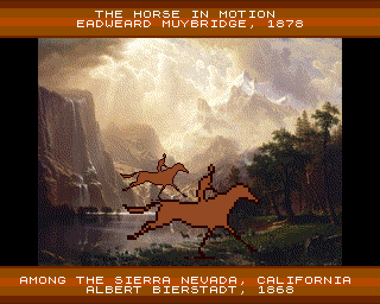
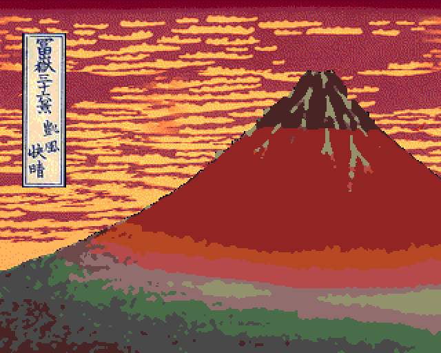
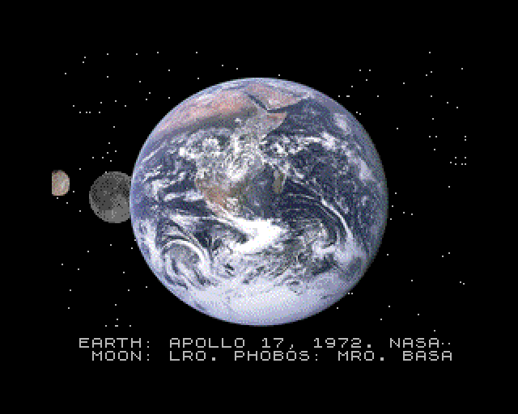

# Examples for the ZX Spectrum Next

Three small programs that ship inside ZenZX. Each is a `.nex` file, written in Z80N
assembly and assembled with [zenas](https://github.com/ha1tch/zenas); its pictures are
turned into the Next's formats and the `.nex` is put together with `zx`, the command of
[zentools](https://github.com/ha1tch/zentools). The pictures are borrowed from Wikimedia
Commons and are all in the public domain.

Each uses several of the Next's features together, and its source says which and how.

| Example | What it shows | What of the Next it uses |
|---|---|---|
| `gallop` | Muybridge's galloping horse, twice, crossing a Bierstadt painting | Layer 2 256x192; 16-colour sprites, some scaled by two; the DMA, streaming the sprite patterns; the copper, for bands of colour in the border; the tilemap in text mode, for captions in the border |
| `fuji` | Hokusai's Red Fuji with its clouds drifting behind the mountain, from day to dusk | Layer 2 320x256 with a nine-bit scroll; the copper, scrolling the sky in four bands; a 512-tile tilemap over Layer 2; 256-colour sprites over the border; nine-bit palette changes |
| `orbit` | The Moon going round the Earth, behind it and in front, with Phobos round the Moon | Layer 2 with a transparent colour; the layer order changed while it runs; sprites scaled, mirrored and rotated; `PIXELAD` and `SETAE`; the ULA's palette; the Next's own interrupt mode 2 with a CTC timer |

| | | |
|---|---|---|
|  |  |  |

## Running them

A Next program starts from NextZXOS, from an SD card. The Next has two card slots, and
ZenZX keeps a card of its own for the second one, so the card the Next boots from is left
alone:

```
zenzx -next-examples
```

This puts the three examples on that card, `zenzx-card.img` beside the Next's boot files,
making it if it is not there. A Next started after that (`zenzx -model=next`) has the card
in its second slot, and NextZXOS shows it as drive D: in the Browser press D to change
drive and ENTER on a `.nex` file. From the NextZXOS command line it is `cd "d:"` and then
`.nexload gallop.nex`.

In the GUI the same is in the **SD Card** menu, which takes the Floppy Disk menu's place
while a Next is running: **Insert ZenZX's Card (Examples)** makes the card and puts it in,
and **Insert Card in Slot 2...** takes any card image.

`zenzx -next-add=FILE,FILE` puts any files on the same card, which is how to try a
program of your own. Both options are in the GUI and the headless builds.

On a real Next, or in another emulator, copy the `.nex` files to its card.

## Building them

```
sh build.sh              # all three
sh build.sh fuji         # one
```

This needs `zx` 0.14.4 or later and `zenas` 0.11.2 or later on the PATH (or named in the
`ZX` and `ZENAS` variables), and nothing else: it runs on Linux and on macOS. Each example
is built in its own folder: the pictures in `art/` are encoded into `build/`, the source
is assembled, and the `.nex` is written beside the source.

| Step | Command |
|---|---|
| A picture for Layer 2 | `zx next bitmap encode -mode 256x192` (or `320x256`), with `-palette` for its colours |
| Sprite patterns | `zx next sprite encode`, `-depth 4` for 16-colour ones |
| A tilemap and its tiles | `zx next tiles encode -depth 4 -map16 -dedup mirror` |
| The code | `zenas assemble name.asm build/name.bin --next` |
| The `.nex` | `zx next nex build`, with the picture as the loading screen (`-screen l2=`) or in banks (`-bank`), and the code with `-bin 0x8000=` |

Three things found on the way that the build works round:

- `zx` does not yet dither a picture to the Next's three bits a channel, so the paintings
  are dithered when they are prepared (below).
- A 320x256 loading screen makes the file NEX V1.3, which the `.nexload` on the
  distribution's card refuses. `fuji` puts its sky in the file as five banks instead and
  stays V1.2.
- `zenas` takes `INCBIN` paths from the folder it is run in, so `build.sh` runs it in the
  example's folder.

## The pictures

The files in each `art/` folder were cut from the originals by the scripts in `tools/`
(`prepare_gallop.py`, `prepare_fuji.py`, `prepare_orbit.py`), which need Python with
Pillow. They are kept as the record of what was done to each picture: scaling, cutting a
shape out of its background, dithering to the Next's colours. Building does not use them.

| Used in | Original, on Wikimedia Commons | By | Status there |
|---|---|---|---|
| `gallop`, the riders | [The Horse in Motion.jpg](https://commons.wikimedia.org/wiki/File:The_Horse_in_Motion.jpg) | Eadweard Muybridge, 1878 (Library of Congress) | Public domain |
| `gallop`, the background | [Albert Bierstadt - Among the Sierra Nevada, California - Google Art Project.jpg](https://commons.wikimedia.org/wiki/File:Albert_Bierstadt_-_Among_the_Sierra_Nevada,_California_-_Google_Art_Project.jpg) | Albert Bierstadt, 1868 | Public domain |
| `fuji` | [Red Fuji southern wind clear morning.jpg](https://commons.wikimedia.org/wiki/File:Red_Fuji_southern_wind_clear_morning.jpg) | Katsushika Hokusai, about 1830 | Public domain |
| `orbit`, the Earth | [The Earth seen from Apollo 17.jpg](https://commons.wikimedia.org/wiki/File:The_Earth_seen_from_Apollo_17.jpg) | NASA, the Apollo 17 crew, 1972 | Public domain (a work of NASA) |
| `orbit`, the Moon | [Moon nearside LRO.jpg](https://commons.wikimedia.org/wiki/File:Moon_nearside_LRO.jpg) | NASA / GSFC / Arizona State University, 2010 | Public domain (a work of NASA) |
| `orbit`, Phobos | [Phobos colour 2008.jpg](https://commons.wikimedia.org/wiki/File:Phobos_colour_2008.jpg) | NASA / JPL-Caltech / University of Arizona, 2008 | Public domain (a work of NASA) |

The status is as each file's page on Commons gave it on 2026-11-16. The captions `gallop`
and `orbit` draw use the character set of the ROM in the machine; none is in the files.

## Checked against

Each example was started from the NextZXOS command line in ZenZX and in jnext 1.3.0 and
shows the same picture in both. They were not run in CSpect or on a Next.
