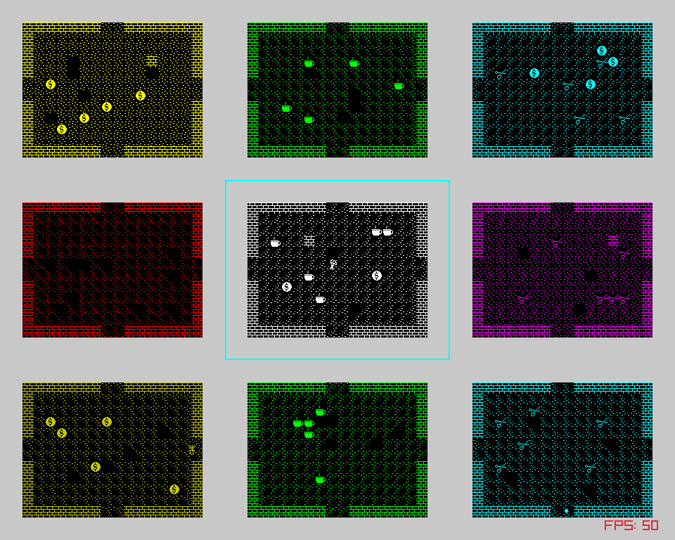

# A connected world across nine Spectrums

Nine ZX Spectrums, each drawing one screen of a larger world, wired together
over ZenZX's link so a character can walk from one machine's screen onto its
neighbour's, and a ball, a pair of scissors and a plant pot drift and bounce
from screen to screen. No machine knows the shape of the world; `host.py`
holds the 3x3 map and routes what leaves one screen onto the opposite edge of
the next. The world is a torus: off the top is the bottom, off the left is the
right.

## What is here

| File | What it is |
|------|------------|
| `world.asm` | The engine: tile background, a walking character, three drifting movers (ball, scissors, pot) sharing one table-driven move/bounce/cross routine, wall collision, the link edge-crossing. Z80, assembled with `zenas`. |
| `assets.asm` | The tile and sprite bitmaps -- `brickything`'s tiles and character (with left- and right-facing walk frames) and a centred ball, plus the scissors tile and a drawn plant pot as the two extra movers. |
| `rooms.asm` | Nine screens, each a 16x12 grid of 16x16 tile cells, with wall borders open in the middle of each edge. |
| `host.py` | The world host: holds the 3x3 grid, tells each machine its room, and routes a character or mover leaving one edge onto the opposite edge of the neighbour, wrapping around at the border (a torus). |
| `world.tap` | The game, already assembled -- so the example runs without an assembler. `run.sh` uses it as it is; `zenas` is only needed to rebuild it after a change to the sources. |
| `run.sh` | Launches `zenzx` with the parameters this example needs and starts the host. It rebuilds the tape if `zenas` is present and the sources changed, otherwise runs `world.tap` as shipped. It does not build the emulator. |

## Running it

You need the `zenzx` GUI built (`make build` puts it in `dist/`). The game
tape ships prebuilt, so `zenas` is optional -- only needed to rebuild the
tape after changing the sources.

    sh examples/world/run.sh

It looks for `zenzx` in `dist/` and at the repository root (set `ZENZX` to
point elsewhere) and `zenas` on the `PATH` or a sibling checkout (set
`ZENAS`), and runs the shipped `world.tap` when no assembler is found.

Walk with **Q/A/O/P** (up/down/left/right); the character faces the way it
walks. Walk off an edge and it steps onto the neighbouring screen, and the
keyboard follows it there (`run.sh` passes `-focus-follow`), so you keep
driving the same character across screens. The ball drifts and bounces
between screens on its own. There is one character and one ball in the whole
world: the character starts on the centre machine, the ball on a corner one.
You can still switch machines by hand with **Alt+1**..**Alt+9** or a click.

## How it works

The engine reuses the Oakhollow sprite routines and `brickything`'s art; the
machines are tied together over ZenZX's own `-multi`/`-listen`/`-autorun`.
The crossing protocol, the edge-routing, and where each piece comes from are
in [`docs/link.md`](../../docs/link.md#a-connected-world-across-nine-spectrums).
